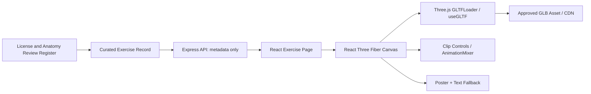
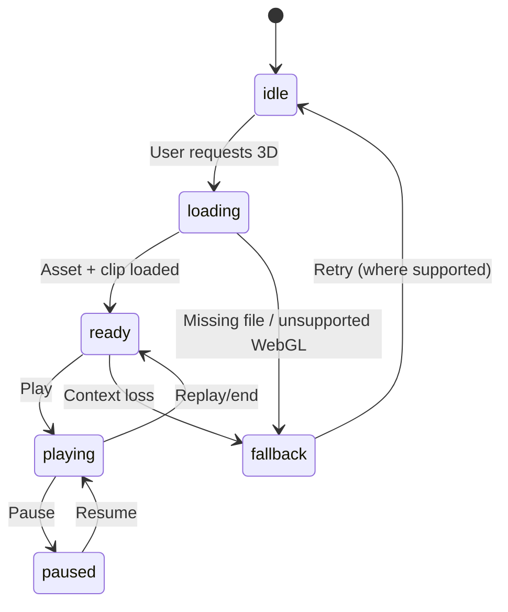

# FitTrack — Realistic Anatomical 3D System Specification

> **Project:** FitTrack · **Version:** 2.0 planning baseline · **Prepared:** 2026-11-18  
> **Status:** Design/specification only; no implementation, live deployment, production security, test pass, medical accuracy review, or third-party asset license is claimed.  
> **Constraints:** 2 developers · 8-week delivery window · MongoDB, Express.js, React.js, Node.js (MERN) · responsive web app.  


## 1. Objective, feasibility and truth boundary
Deliver a **realistic human anatomical character** (visibly musculoskeletal / muscle-structured where licensed) demonstrating at least **one medically/nonmedically reviewed exercise movement** inside React. Anatomy realism, exercise biomechanical accuracy and rig compatibility are different requirements. A photoreal render alone is not evidence of valid form. The product is not a simulator or automated injury-prevention/medical system.

### Acceptance levels
- P0: one approved realistic rigged human, one reviewed movement clip, playable on reference desktop, text/static alternative everywhere, valid media rights, basic WebGL errors addressed.
- P1 stretch: 6–10 reviewed clips, camera orbit/accessibility refinement, muscle-region highlights *if model has reliable segment/region IDs*; entire catalog animation coverage is not a 2-month promise.
- P2 research: pose comparison, motion capture capture pipeline, biomechanics feedback, calibrated anatomical deformation—requires additional expertise, measurement and budget.

## 2. Asset and runtime architecture


Browser downloads only approved static GLB/texture/poster assets via HTTPS with strict trusted origin or same-origin policy; media IDs never allow arbitrary user-supplied URLs to be fetched by backend. MongoDB holds exercise-to-media association and review metadata, **not binary model files**.

## 3. Candidate toolkit and standards
- React Three Fiber is a React renderer for Three.js, not a replacement for MERN; exact supported major must be tested with installed React version.
- glTF 2.0 / `.glb` supports node animation, skeletal skinning, joints and named animation tracks. glTF does not define user-facing playback policy; the app must implement controls.
- Use a **single reference skeleton/rig** when possible; retargeting foreign animations requires joint-name/orientation/rest-pose verification.
- Blender or another offline DCC tool may be used by asset creator; not required in runtime and does not replace MERN stack.
- Adobe Mixamo is a candidate source, not guaranteed to contain correct squats/presses or anatomically detailed mesh. Verify current terms, redistribution limitations and applicable character/clip license. See `CONTENT-LICENSING.md`.
Sources: https://registry.khronos.org/glTF/specs/2.0/glTF-2.0.html ; https://r3f.docs.pmnd.rs/getting-started/introduction ; https://helpx.adobe.com/creative-cloud/faq/mixamo-faq.html

## 4. Approved asset data contract (proposal)
```json
{
  "exerciseId": "66aabbccddeeff0011223401",
  "animation": {
    "status": "verified",
    "format": "glb",
    "assetUrl": "/assets/exercises/bench-press.v1.glb",
    "posterUrl": "/assets/exercises/bench-press.webp",
    "clipName": "bench_press_loop",
    "modelRigId": "fittrack_human_v1",
    "primaryMuscleRegions": ["chest"],
    "verifiedAt": "2026-11-18T00:00:00.000Z",
    "reviewRef": "ANAT-001"
  }
}
```
All values and dates above are **illustrative schema examples**; no named media asset/review has actually been created, licensed or approved. Server returns `animation: null` or `status: "pending"` for missing/unapproved media. No `verified` status may be stored without a review record.

## 5. Asset review stages and evidence
```
Discovered -> License checked -> Rig-compatible -> Motion tested
     -> Anatomical review -> Media optimized -> Approved/Published
```
A publish gate **fails** if any prior stage lacks evidence. Track asset name, URI, checksum, author, asset source, license, redistribution permissions, attribution condition, clip/exercise matching, rig ID, reviewer, review date, known limitations and rollback asset revision in `ASSET-REGISTER.md`. Store raw human reviewer notes separately from display fields.

Anatomical reviewer checks joint range, posture cues, hazardous positions, target muscle representation, symmetry and whether loops mislead; do not invent certification. If no qualified reviewer is available, present an ordinary 'illustrative demonstration' with explicit review status and do **not** label the form verified; discuss adjusting P0 review gate with product owner.

## 6. 3D model taxonomy and highlight mapping
`primaryMuscleGroup` uses the existing 8 required API values; `secondaryMuscleGroups[]` is allowed. Optional `muscleRegionIds[]` uses a controlled internal lookup with mesh groups/vertex IDs—e.g. `pectoralis_major_l`, `pectoralis_major_r`. Group labels **must not** imply isolated muscle activation/accurate EMG. Region highlighting is only possible if mesh is segmented or geometry/material mapping reviewed; shader glow is not anatomical correctness.

## 7. Rendering, performance and safety
**Initial targets (budget hypotheses, require measurement):** compressed first visible 3D payload ≤5 MiB when feasible; no hero WebGL as critical rendering dependency; viewer interactive ≤3 seconds on a specified test desktop network/device; use lazy loading, content hash URLs, LOD only where needed, keep draw calls low and dispose geometries/materials on unmount. Exact acceptance budgets/conditions must be ratified and measured; never claim a target was achieved without profiling.

- Avoid downloading 3D on every route. Preload only if user opts into demo or viewport is near and network policy permits.
- Disable antialiasing/high DPR as needed for low-end hardware; cap pixel ratio; pause rendering when hidden.
- Use 2D image/text fallback when WebGL/context creation fails; explain loss of only the optional visual feature.
- Set camera control limits to avoid confusing upside-down view; include reset camera; ensure transparent backgrounds do not reduce text contrast.
- Default animation starts paused for reduced motion and optionally for general sessions; user controls Play/Pause/Replay/Speed.
- Respect `prefers-reduced-motion`; animation is not required to operate the workout logger.
- No sensitive fitness profile data in public asset URLs or public query strings.

## 8. Client state machine


## 9. Component contract / pseudo-code
```jsx
function ExerciseDemo({ animation, instructions, prefersReducedMotion }) {
  // Render instructions and a static poster first.
  // Load WebGL canvas only for approved animation metadata.
  // Show Play/Pause/Replay controls with accessible names.
  // If reduced motion, start paused; if load fails, keep poster + text.
  // No network call for an arbitrary URL received from user input.
}
```

## 10. Verification matrix
| ID | Test | Required result |
|---|---|---|
| 3D-T01 | Approved GLB/clip load | Named clip loads and plays without console error |
| 3D-T02 | Invalid/missing URL | Text and poster still available; no broken page |
| 3D-T03 | WebGL disabled/context lost | Accessible fallback shown |
| 3D-T04 | Reduced motion | No autoplay; manual control works |
| 3D-T05 | Asset without license | Cannot publish as approved |
| 3D-T06 | Mismatched exercise clip | Cannot associate it with another exercise without review |
| 3D-T07 | Mobile slow network | Other page content remains interactive |
| 3D-T08 | Keyboard | Controls operable and status announced |
| 3D-T09 | Asset revisions | Cache-busting does not change old workout snapshots |

## 11. Week-1 proof-of-feasibility gate
Before promising realistic 3D as P0, demonstrate a legally usable actual anatomical model with animation clip playing in the React app; review rig constraints, download size, low-end fallback and a written asset-license entry. If impossible, surface as **blocked**, do not replace with a visually unrelated asset while claiming requirement completion.
