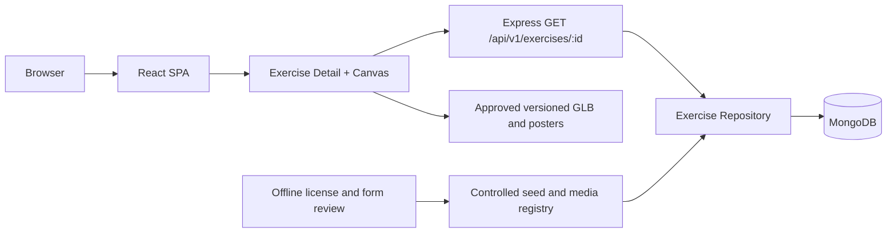
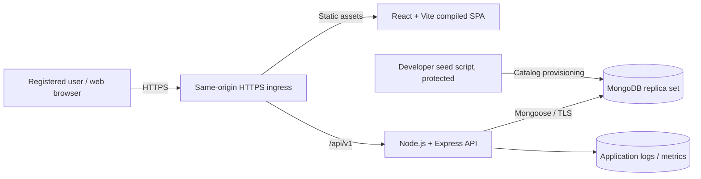
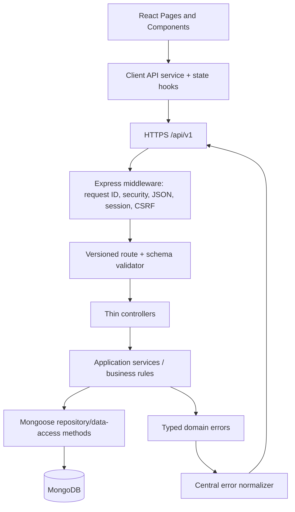
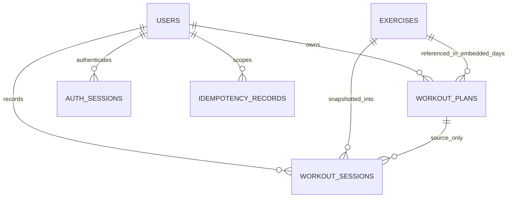
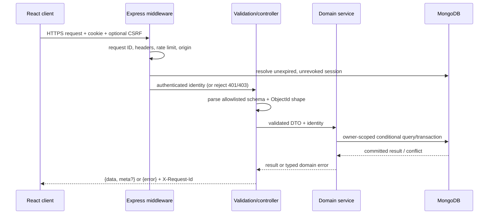
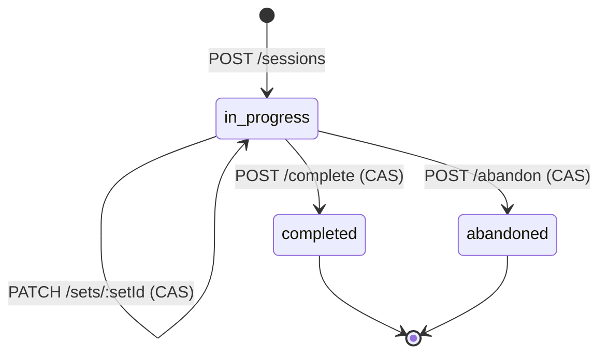
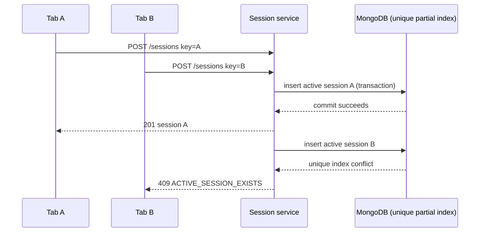
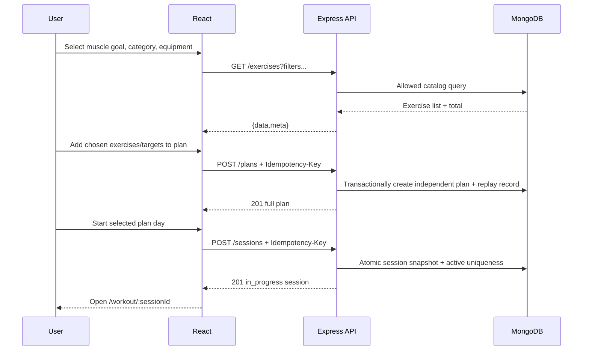
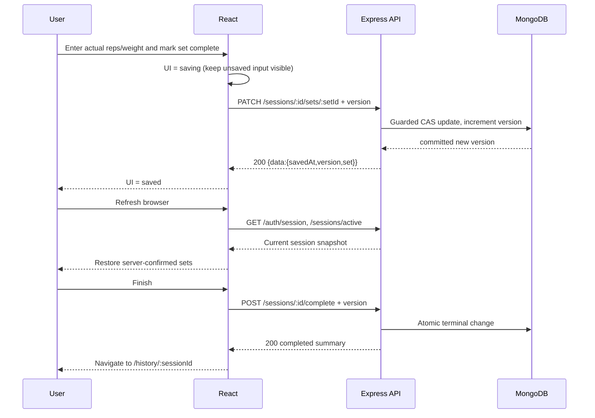
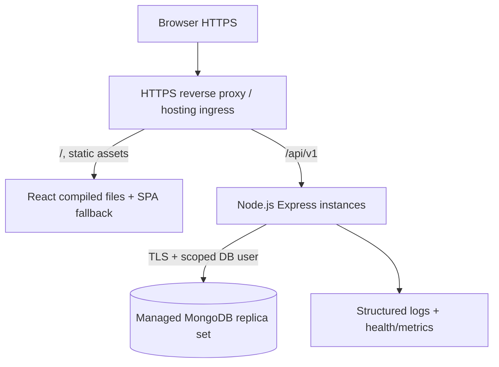

# FitTrack — System Architecture Specification — Version 2.0

**Document:** `ARCHITECTURE.md`  
**Version:** 2.0.0 (proposed implementation baseline)  
**Date:** 2026-11-18  
**Status:** Updated design for review; implementation, security, performance and production operation **not verified**  
**Product:** FitTrack — Personal Workout Tracker (Option A)  
**References:** `idea.md`, `REQUIREMENTS.md` (SRS), `PLANNING.md`, `ADR-DECISIONS.md`, `DESIGN.md`, `API-CONTRACT.md`

> **Governance:** This document describes *how* to build the approved product. The SRS defines *what* must work; `API-CONTRACT.md` is the source of truth for HTTP routes, payloads, responses, and errors; `DESIGN.md` is the source of truth for UI behavior and visual tokens. Proposed implementation choices below do **not** retroactively approve the open decisions in `ADR-DECISIONS.md`. Resolve conflicts by recording a change request and updating the relevant documents together.

---


## Version 2.0 architectural extension — mandated user changes

> **Project:** FitTrack · **Version:** 2.0 planning baseline · **Prepared:** 2026-11-18  
> **Status:** Design/specification only; no implementation, live deployment, production security, test pass, medical accuracy review, or third-party asset license is claimed.  
> **Constraints:** 2 developers · 8-week delivery window · MongoDB, Express.js, React.js, Node.js (MERN) · responsive web app.  


The retained architecture below is a **proposed implementation blueprint**. Its modular Express structure, owner-scoped data, session snapshots, concurrency and server-session recommendations remain intact. The **following deltas are binding product constraints** subject to review of exact technology choices.

- **8 weeks / 2 developers:** architecture and code structure must remain lean; no microservices, heavy animation backend, custom AI model or unnecessary cloud service. P0 critical path is auth -> 32+ exercises -> plans -> saved sessions -> history/analytics -> release; 3D is a parallel proof-of-feasibility started W1.
- **Brand:** Ocean Breeze + Manrope; two full-viewport landing sections with variable-height middle and integrated footer (CSS `min-height:100dvh` with fallbacks). Replaces previous lime accent concept.
- **3D:** React Three Fiber/Three.js supporting UI module `features/exercise-3d`, lazy GLB loading, bounded GPU resources, named animation playback, fallback poster/text, explicit optional `animation` metadata from exercise endpoint, media versioning and review registry. **No extra backend framework, DB, or microservice.**
- **Source-of-truth migration:** SRS `REQUIREMENTS.md`, HTTP DTO `API-CONTRACT.md`, canonical database model `DATABASE-SCHEMA.md`, 3D pipeline `3D-ANIMATION-SYSTEM.md`, authored assets in `ASSET-REGISTER.md`.
- **Content scale:** seed ≥32 in 8 groups for P0; expanding to 80–120 is P1/stretch. Only physically reviewed animation assets are declared ready.
- **Operations:** media may be served from immutable static file host or CDN; current W8 provider is TBD. Asset files do not live in MongoDB BSON documents. HTTP `Cache-Control` for private JSON is no-store; hashed public static files may be aggressively cached.

### 3D component and trust boundaries


**Invariants:** No 3D assets published without provenance/license check; no `animationAvailable=true` unless verified. No client can modify exercise media metadata. No public 3D asset request leaks workout or fitness profile data. Fallback is independent of WebGL.

### Capacity, release and evidence
A scalable modular monolith is a design that **can be tested and evolved**, not proof of capacity. Do not claim high throughput, production readiness, WCAG conformance, anatomical correctness or security audit completion without named test environments, actual measurements and an identified reviewer. See `TEST-PLAN.md`.

---

## 1. Executive Architecture Summary

FitTrack is a **single-user-account, multi-tenant-by-data-ownership** workout application: each registered user manages their own training goals, discovers curated exercise options, maintains multiple workout plans, records performed sets, resumes a workout after refresh, and reviews completed history and basic progress. It is *not* a gym membership, trainer, payment, social, or AI-coaching platform.

### 1.1 Fixed technology boundaries

| Layer | Required choice | Design use |
|---|---|---|
| Web client | **React** with **Vite** | Single-page application, responsive authenticated screens |
| Styles | **Tailwind CSS** | Dark-first tokens, responsive components, focus/interaction states |
| API runtime | **Node.js** | Server runtime |
| Web framework | **Express.js** | Versioned REST API (`/api/v1`), middleware, routing |
| Database | **MongoDB** | Persistent account, plan, session, and catalog records |
| ODM | **Mongoose** | Schemas, validation, indexes, query construction |
| Data exchange | **JSON over HTTPS** | `camelCase`, UTC ISO 8601, ObjectId strings |
| Testing | Proposed Vitest/React Testing Library, Supertest and Playwright | Unit, integration, end-to-end tests; confirm before M1 |

Do **not** replace React with Next.js, Express with NestJS, or MongoDB with SQL merely for convenience. Additions such as a Redis cache, queue, cloud object storage, social login, or AI personalization are **not MVP dependencies**.

### 1.2 Scope and releases

**P0 / MVP:** account registration/login/logout and profile; curated catalog of **at least 32** seeded exercises (at least 4 each across Chest, Back, Shoulders, Biceps, Triceps, Legs/Glutes, Core, Cardio); browse/search/filter and choose exercises for *any* supported fitness goal; multiple independent workout plans; start exactly one active session; edit performed sets; server-acknowledged save and refresh resume; complete or abandon; read-only history; basic dashboard and progress; secure and responsive dark-first experience.

**P1 / Phase 2:** historical body measurements, password change/reset, custom exercises, exercise alternatives or templates, in-session ad hoc additions, advanced analytics, rest timer, and polished light-mode switching. Do not silently treat proposed `bodyMetrics` or theme preference persistence as P0.

### 1.3 Quality drivers

1. **Data isolation:** no user can read or change another user's private record.
2. **Historical truth:** completed sessions preserve actual values and display snapshots when source plans change or are archived.
3. **Retry safety:** an interrupted POST or double-click cannot accidentally duplicate a plan or live session.
4. **Concurrent correctness:** two tabs cannot create two active workouts or overwrite each other's sets silently.
5. **Mobile usability:** users can quickly log sets with gloves/sweaty hands on a narrow screen; clear save and error states.
6. **Traceable scope:** all features map to SRS, API and delivery milestones.

---

## 2. System Context, Trust Boundaries, and Deployment Units

### 2.1 Context diagram



**Deployment units:** (1) compiled React static assets, (2) stateless Express API processes, (3) managed MongoDB replica set, (4) secure environment/configuration and observability. A *replica set* is recommended for MongoDB transactions even if deployment initially uses only one application instance. A local single-node replica set can be used during development/integration tests.

### 2.2 Trust model

| Boundary | Risk | Countermeasure |
|---|---|---|
| Browser → API | Untrusted requests and spoofed `userId` | Validate every body/query/param; derive identity from server session |
| Cookie → session store | Forged/stolen/reused session | CSPRNG opaque ID, HttpOnly/Secure cookie, expiry, revocation, rotation |
| Browser form → state-changing API | CSRF | CSRF header token bound to session + exact origin checks |
| API → MongoDB | Operator injection, excessive queries | Explicit DTO allowlists, Mongoose filters, indexes, pagination limits |
| Public catalog → private sessions | Cross-account leak | All plans/sessions filtered by `userId` at query time |
| Deployment → secrets | Token/URI exfiltration | Secret manager/env vars, least-privilege database credentials, sanitized logs |

Only **catalog discovery** is shared across accounts, and it is read-only/authenticated for MVP according to `API-CONTRACT.md`. All workout and profile resources are private.

### 2.3 Architectural style

A **modular monolith** (not microservices) is appropriate to the university MVP: one Express deployment with explicit domain modules and independent controllers/services/repositories. It simplifies atomic workflows, testing, and deployment while leaving clear boundaries for possible growth. Client communicates exclusively through documented APIs; it never accesses MongoDB directly.

---

## 3. Component Architecture and Dependency Rules



### 3.1 Responsibility matrix

| Layer | Responsibilities | Must not do |
|---|---|---|
| React pages | Load route data, compose UI, handle navigation and form state | Rely on client-only authorization |
| Components/hooks | Reusable inputs, save-state UI, controlled workout form, effects | Persist secret credentials or directly use DB |
| API client | Base path, `credentials: include`, CSRF header, typed errors, request IDs | Claim mutation success before 2xx |
| Express middleware | CORS/origin, session, CSRF, rate limiting, request ID, size cap | Apply user-supplied MongoDB filters unvalidated |
| Routes/validators | Allowlist query/JSON fields and URL params; map to controller | Perform database business rules |
| Controllers | Map request → service → response envelope/status | Encode concurrency logic or return raw DB errors |
| Services | Ownership, domain invariants, state transitions, transaction boundaries | Trust payload-supplied user identity |
| Repositories | Mongoose filters, transactions, aggregation and index-backed queries | Implement HTTP response semantics |
| Models | Schema shape, defaults, basic validation, index declarations | Substitute for application authorization |

**Dependency direction:** router → controller → service → repository/model; shared primitives may be imported downward, never cyclical. Domain exceptions (e.g., `ActiveSessionExistsError`) are translated to API codes once in error middleware.

### 3.2 Domains / bounded modules

- `auth`: signup/login/logout, pre-auth bootstrap, server sessions, CSRF.
- `profile`: only current-user demographics/goal/equipment preferences.
- `exercises`: read-only catalog, searchable using explicit filters and stable sort.
- `plans`: independent plan CRUD, nested day/exercise validation, archive, optimistic versioning.
- `sessions`: create immutable source snapshot, update performed set, complete/abandon, active recovery.
- `analytics`: history summaries, week grouping, completed-only dashboard/progress.
- `platform`: validation, errors, authz, rate limit, observability, health.

### 3.3 Frontend navigation contract

Use `react-router-dom` (proposed) with pages `/`, `/register`, `/login`, `/dashboard`, `/exercises`, `/exercises/:id`, `/plans`, `/plans/:id`, `/workout/:sessionId`, `/history`, `/history/:sessionId`, `/progress`, `/profile`. `/workout/:sessionId` (a **session ID**, *not* a plan ID) matches `DESIGN.md` and `API-CONTRACT.md`. Protected routes improve UX only; security remains server-side. React's only source of truth for authenticated identity is `GET /api/v1/auth/session`.

---

## 4. Data Model — MongoDB and Mongoose

### 4.1 Entity relationship overview



Embedded `days[]` and `exercises[]` belong to `workoutPlans`; embedded `exercises[]` and `sets[]` belong to `workoutSessions`. MongoDB references allow catalog reuse, while snapshots preserve older facts without requiring current catalog data.

### 4.2 Collection design matrix

| Collection | Purpose | Access policy | Core indexing |
|---|---|---|---|
| `users` | Credentials + fitness profile | current identity only | unique normalized email |
| `exercises` | Seeded, shared catalog | authenticated read-only | category/filter/search indexes |
| `workoutPlans` | Per-user plan templates and archived originals | owner only | owner + archive + update time |
| `workoutSessions` | Current/terminal workouts and immutable completed results | owner only | unique partial active owner; owner + status + timestamp |
| `authSessions` | Revocable server-side login sessions | server only | unique hashed session lookup + TTL |
| `idempotencyRecords` | Durable response replay for critical POSTs | server only | unique compound scope + TTL |
| `bodyMetrics` | Historical body measurements | **P1 only** | owner + recorded date, when implemented |

**IDs:** MongoDB `_id:ObjectId` internal; serialize as lowercase 24-hex `id`. `createdAt`/`updatedAt` ISO UTC. Reject arbitrary `userId`, `status`, `version`, timestamps, hashed secrets, and dotted/operator update paths from user mutations.

### 4.3 `users` schema

```js
{
  _id: ObjectId,
  name: String,              // 2..80 chars, trimmed
  emailNormalized: String,   // lowercase, trimmed, unique
  passwordHash: String,      // Argon2id preferred; never returned
  primaryGoal: String,       // enum from api.md; default general_fitness
  experienceLevel: String,   // default beginner
  equipmentPreferences: [String],
  age: Number|null,
  heightCm: Number|null,
  currentWeightKg: Number|null,
  createdAt: Date,
  updatedAt: Date
}
```

Use `UserSchema.index({emailNormalized:1},{unique:true})`. Normalize consistently before validation and query, and catch duplicate-key races as `409 EMAIL_ALREADY_REGISTERED`. **Do not** include P1 body-measurement timelines or role/admin features in the user model as MVP commitments. Enumerations, valid ranges, profile patch semantics and password bounds are inherited from `API-CONTRACT.md` and SRS, not duplicated in independently-maintained constants.

### 4.4 `exercises` schema

```js
{
  _id: ObjectId,
  name: String,
  slug: String,               // unique stable catalog key
  primaryMuscleGroup: String, // one of 8 approved categories
  secondaryMuscleGroups: [String],
  equipment: [String],
  difficulty: String,
  goalTags: [String],         // recommendations, NOT visibility controls
  trackingType: String,       // reps_weight | reps_only | duration
  instructions: [String],
  imageUrl: String|null,
  animation: Object|null, // verified metadata, exact DTO in API-CONTRACT.md
  isActive: Boolean,
  createdAt: Date,
  updatedAt: Date
}
```

Use unique `{slug:1}`; `{isActive:1,primaryMuscleGroup:1,name:1,_id:1}` and targeted compound indexes for frequent allowed filters. A MongoDB text index on controlled name/instructions or an escaped, bounded prefix search is **proposed**, subject to query-plan measurement. Avoid unbounded case-insensitive regex scans. The catalog is seeded **idempotently** with ≥32 exercises / ≥4 per category; users can explore every option irrespective of their stated goal. Exercise `trackingType` governs permitted performed-set fields.

### 4.5 `workoutPlans` schema

```js
{
  _id: ObjectId,
  userId: ObjectId,
  name: String,
  description: String,
  days: [{
    _id: ObjectId,          // serialized as day.id
    label: String,
    weekday: Number|null,   // 0=Sun ... 6=Sat; duplicates allowed
    exercises: [{
      _id: ObjectId,        // stable plan entry ID
      exerciseId: ObjectId, // catalog reference
      position: Number,
      targetSets: Number,   // 1..12
      targetReps: Number|null,
      targetDurationSec: Number|null,
      targetWeightKg: Number|null
    }]
  }],
  version: Number,          // starts at 1; explicit compare-and-swap
  archivedAt: Date|null,
  createdAt: Date,
  updatedAt: Date
}
```

Constraints: 1–7 days, 0–20 exercises per day, contiguous distinct positions, target values based on catalog `trackingType`; at least one selected exercise before starting a day. **Plan update:** absent `days` means retain existing array; supplied `days` fully replaces it after validating nested IDs against the original owner/plan. Preserve IDs for unchanged nested elements. `DELETE` is an archive, **not** data destruction: old sessions still reference their source ID but their snapshot never depends on plan availability.

**Indexes:** `{userId:1,archivedAt:1,updatedAt:-1,_id:1}` for list; `{_id:1,userId:1}` generally leverages `_id` unique index but owner must be included in access predicates. Confirm indexes via `explain()` and test on realistic sample distributions.

### 4.6 `workoutSessions` schema

```js
{
  _id: ObjectId,
  userId: ObjectId,
  sourcePlanId: ObjectId,
  sourceDayId: ObjectId,
  planNameSnapshot: String,
  dayLabelSnapshot: String,
  status: String,             // in_progress | completed | abandoned
  startedAt: Date,
  completedAt: Date|null,
  abandonedAt: Date|null,
  version: Number,            // starts at 1
  exercises: [{
    _id: ObjectId,           // unique within session
    exerciseId: ObjectId,    // reference for diagnostics, NOT display source
    nameSnapshot: String,
    trackingType: String,
    position: Number,
    targetSets: Number,
    targetReps: Number|null,
    targetDurationSec: Number|null,
    targetWeightKg: Number|null,
    sets: [{
      _id: ObjectId,         // unique within session
      position: Number,
      reps: Number|null,
      weightKg: Number|null,
      durationSec: Number|null,
      completed: Boolean
    }]
  }],
  createdAt: Date,
  updatedAt: Date
}
```

Session creation copies plan/day/exercise labels, order, targets and tracking types. Initially create exactly `targetSets` uncompleted set entries. **Never rehydrate completed display facts from edited plans/catalog.** Terminal sessions are read-only, no re-open operation in v1. `durationMinutes` and aggregate counts may be calculated at response time; if cached, they must be updated atomically at the completion transition and verified against source values.

**Critical partial unique index:**

```js
WorkoutSessionSchema.index(
  { userId: 1 },
  { unique: true, partialFilterExpression: { status: 'in_progress' },
    name: 'one_active_workout_per_user' }
);
```

Also `{userId:1,status:1,completedAt:-1,_id:-1}` for history and completed analytics, and `{userId:1,startedAt:-1,_id:-1}` for all/session lists. The *unique index*, not a preliminary read, is the final guard against simultaneous starts. Catch `E11000` on this index and map to `409 ACTIVE_SESSION_EXISTS`; first query the owner's current session to provide safe `activeSessionId` where possible.

### 4.7 `authSessions` and `idempotencyRecords`

**Server-side session document (proposed TD-01):**

```js
{
  _id: ObjectId,
  tokenHash: String,         // hash of random opaque cookie token
  userId: ObjectId|null,    // optional bounded pre-auth state
  csrfSecretHashOrState: String,
  createdAt: Date,
  expiresAt: Date,
  revokedAt: Date|null
}
```

Lookup via unique `tokenHash`; TTL on `{expiresAt:1}` (`expireAfterSeconds:0`). **TTL is asynchronous cleanup, not security enforcement:** middleware must check `expiresAt > now` and `revokedAt === null` on every authenticated request. Use a 7-day absolute lifetime only once approved; rotate on login, clear/revoke on logout. For CSRF bootstrap pre-auth, either bounded pre-auth session or signed short-lived token must follow the `API-CONTRACT.md` contract; approve exact details before M2.

**Idempotency record (proposed TD-02):**

```js
{
  _id: ObjectId,
  userId: ObjectId,
  method: String,
  routeKey: String,          // normalized route, not untrusted raw URL
  key: String,               // validated UUID from Idempotency-Key
  payloadHash: String,       // hash of canonical validated request
  state: String,             // processing | completed
  statusCode: Number|null,
  responseBody: Object|null,
  resourceId: ObjectId|null,
  createdAt: Date,
  expiresAt: Date
}
```

Unique index `{userId:1,method:1,routeKey:1,key:1}`; TTL on `expiresAt`. Response snapshots contain **no cookies, secrets or other user's data**. Proposed retention ≥24h. **Design caution:** TTL alone cannot guarantee correctness if a request is retried after expiry; document that replay guarantee applies only within the retention window, expose clear client behavior, and do not make arbitrary “exactly once forever” promises.

### 4.8 Schema implementation rules

- Use `strict:'throw'`/explicit DTO allowlists for mutation input rather than allowing unknown fields.
- Subdocument `_id` generation is server-owned; request nested `id` must be verified before reuse.
- Enforce string/array/numeric constraints at request validation **and** in business logic; Mongoose validates persistence structure.
- Never accept raw request JSON as an update document (`Model.updateOne(filter, req.body)` is forbidden).
- Use safe projections and `toJSON` transforms to hide `_id`, password/session hashes, `__v` and other internals; serialize API `version` explicitly.
- Only use indexes when verified with integration tests; excessive indexes slow writes.
- Separate P1-only `bodyMetrics` model and repository from P0 until approved.

---

## 5. REST Mapping and Request Lifecycle

**Base URL:** `/api/v1`. API `data` and `meta` envelopes, exact endpoint names, status codes and validation follow `API-CONTRACT.md` (do not invent aliases). Key groups:

| Area | Routes | Owner check |
|---|---|---|
| Health/CSRF | `GET /health`, `GET /auth/csrf` | public/bootstrap |
| Auth | `POST /auth/register`, `/auth/login`, `/auth/logout`; `GET /auth/session` | user session where appropriate |
| Profile | `GET/PATCH /profile` | session user |
| Exercises | `GET /exercises`, `/exercises/:exerciseId` | authenticated, shared read-only |
| Plans | `GET/POST /plans`; `GET/PATCH/DELETE /plans/:planId` | `{_id,userId}` |
| Sessions | `POST /sessions`; `GET /sessions/active`, `/sessions/:sessionId`; `PATCH /sessions/:sessionId/sets/:setId`; `POST /sessions/:sessionId/complete`, `/abandon`; `GET /sessions` | `{_id,userId}` + state |
| Analytics | `GET /dashboard/summary`, `GET /progress/summary` | session user |

### 5.1 Request pipeline



Use `Content-Type: application/json` for bodies; cap to proposed 64 KiB and apply 415 for unsupported payload media types. Invalid query/IDs produce 400; malformed JSON 400; semantically invalid forms 422. Auth errors 401, CSRF 403, foreign owner resources 404, stale revisions 409. Validate query parameters before constructing MongoDB sorts/filters; never accept a client-provided pipeline or MongoDB operator.

### 5.2 Pagination and filtering

All list endpoints use **1-indexed page and `limit <= 50`**. Invalid fractional/negative/over-cap inputs return `400 INVALID_QUERY`, rather than silent clamping. Return `{data:[...],meta:{page,limit,total,totalPages,hasNextPage}}`. Apply exactly the same owner/status/filter predicates to count and retrieval. Accept only enumerated sort keys and filter names from `API-CONTRACT.md`; add deterministic `_id` tie-break sorting for stable pages. A future cursor-based API is a separate change, not assumed P0.

### 5.3 API error mapping

Central middleware maps domain failures to the codes in `API-CONTRACT.md`: `BAD_JSON`, `INVALID_QUERY`, `UNAUTHENTICATED`, `INVALID_CREDENTIALS`, `CSRF_INVALID`, `FORBIDDEN`, `RESOURCE_NOT_FOUND`, `EMAIL_ALREADY_REGISTERED`, `ACTIVE_SESSION_EXISTS`, `VERSION_CONFLICT`, `INVALID_SESSION_STATE`, `PLAN_ARCHIVED`, `IDEMPOTENCY_KEY_REUSED`, `VALIDATION_ERROR`, `NO_COMPLETED_SETS`, `RATE_LIMITED`, `INTERNAL_ERROR`, `SERVICE_UNAVAILABLE`. Never reveal a stack trace, MongoDB URI, raw error text or a foreign user's existence. Set and echo an opaque `X-Request-Id` for correlation.

---

## 6. Authentication, Session Security, and Authorization

### 6.1 Authentication decision (TD-01, proposed)

Select **revocable server-side sessions** over localStorage JWT for the MVP, because logout/revocation and long-lived workout resumption are straightforward. Cookie example:

```http
Set-Cookie: fittrack.sid=<random-opaque>; HttpOnly; Secure; SameSite=Lax; Path=/; Max-Age=604800
```

Use `Secure` in production, HTTPS everywhere outside localhost, host-only cookie by omitting `Domain`, and avoid `localStorage`/`sessionStorage` for credentials. Cookie token is a CSPRNG-generated random value, stored server-side as a **hash**. Rotate identity/CSRF state after login, revoke active server token on logout. Session expiry must be enforced synchronously even if MongoDB TTL cleanup has not run.

### 6.2 CSRF and origin policy

`GET /auth/csrf` returns an opaque token in `{data:{csrfToken}}` (no-store). All authenticated mutation requests require `X-CSRF-Token` matching session state, and state-changing requests are rejected for unapproved Origin/Referer. Registration and login also require pre-auth token bootstrap. Never rely on `SameSite` alone; explicitly allow only approved origins with credentialed CORS (no wildcard). After authentication rotation, client fetches a *new* CSRF token. Exact bootstrap and storage details remain pending technical sign-off.

### 6.3 Authorization and session ownership

Derive `userId` from authenticated server state, never from JSON or query strings. Plan queries include `userId`; session updates include both ownership and `status:'in_progress'`. For a missing/foreign private ID, return the same `404 RESOURCE_NOT_FOUND`; do not expose an “owner” field. Block catalog editing in P0 even for normal signed-in users.

### 6.4 Password/security controls

Use Argon2id (preferred) or suitably costed bcrypt, unique normalized email, constant-shape generic credential errors, throttling for login/registration, strict JSON allowlists, security headers, bounded payloads, reasonable timeouts, escaped output rendering, parameterized ODM queries, environment-managed secrets and dependency audits. Do not log plaintext passwords, headers containing cookies or CSRF tokens, or full profile bodies.

---

## 7. Atomic Concurrency, Idempotency, and Workouts

### 7.1 Workout state machine



One owner has at most one `in_progress` record. A completed workout requires **at least one valid completed set** and cannot be modified. Abandoned workouts do not contribute to completion metrics. Repeating a matching terminal request returns the original successful result without changing timestamps or counts; requesting an opposing terminal transition returns `409 INVALID_SESSION_STATE`.

### 7.2 Start session: transactional pattern

1. Authenticate, validate CSRF, require UUID `Idempotency-Key`.
2. Find or reserve idempotency record using unique `{userId,method,routeKey,key}`. Compare canonical request hash; mismatched payload → 409.
3. Within a **MongoDB transaction** (recommended production baseline), resolve owned non-archived plan/day and catalog tracking types, create complete server-owned snapshots and uncompleted sets, insert session. Unique partial index enforces the one-active limit.
4. Persist original success status/body under idempotency record within the same transaction; commit. On same-key retry return original response; on competing-key race return `ACTIVE_SESSION_EXISTS` and safe active session ID.
5. For transaction uncertainty, retry according to MongoDB driver's transaction guidelines without duplicating side effects; do not assume any HTTP request was successful merely because the browser timed out.

**Design refinement:** Reserving `processing` outside a transaction needs a crash-recovery lease and reconciliation logic; **avoid it** for MVP by writing resource and final key record in a single transaction. Where transaction support is unavailable, do not weaken this to `findOne` then `create`; provision a replica set or document and test a genuine atomic reservation alternative before M5.



### 7.3 Plan optimistic concurrency

`PATCH /plans/:id` requires `version` and mutable fields. Atomically `findOneAndUpdate({_id, userId,version,archivedAt:null},{$set:validatedChanges,$inc:{version:1}}, {new:true,runValidators:true})` *after* checking nested IDs, catalog refs and all business constraints. On no match, distinguish owner-only not-found/archived from a current-version conflict without disclosing foreign records. Re-fetch/reconcile on 409; never overwrite with last-writer-wins. Archives preserve old sessions.

### 7.4 Set update optimistic concurrency

`PATCH /sessions/:sessionId/sets/:setId` contains the *entire* performed set state plus expected **session** `version` (not set-specific version). Confirm nested set ID exists and type-valid values. Atomically update the targeted set with filter `{_id,userId,status:'in_progress',version,'exercises.sets._id':setId}`, using safe MongoDB `arrayFilters` or an aggregation pipeline that does not inadvertently modify another set; increment `version` once. With multiple nested arrays, use an unambiguous pair of **exercise and set IDs internally** to target the correct element even though the public route supplies only `setId`. Test that no unrelated set is altered. On stale version, return `409 VERSION_CONFLICT`. On success, return confirmed `savedAt` and new version. Avoid stale overwrite from a pending autosave: serialize set writes per session in the client and reconcile with server results.

**API adherence:** `reps_weight` completed sets require reps 1–100 and weight 0–500 kg; `reps_only` needs reps; `duration` needs 1–7200 seconds; uncompleted sets may contain nullable draft values according to `API-CONTRACT.md`. Do not allow a set mutation in terminal states.

### 7.5 Completion and abandonment

Do not implement `read -> modify -> save` races. For completion, atomically compare owner + `status:'in_progress'` + expected version **and** at least one type-valid completed set; update `status`, `completedAt` and version together. If validation cannot be expressed cleanly as one atomic predicate, use a transaction with a guarded compare-and-swap update and recheck within the transaction. Use server clock for `completedAt`. Abandon uses the analogous guarded update. If no write matched, fetch the **owner-scoped** current terminal state: matching terminal action returns the original result without changing it; opposite terminal state returns 409; stale active version returns `VERSION_CONFLICT`.

### 7.6 Idempotency and duplicate prevention matrix

| Write | Contract | Enforcer |
|---|---|---|
| `POST /plans` | Same key + same body replays original 201/body | Transactional idempotency record + unique scoped key |
| `POST /sessions` | Same key/body replays original; different key competes for active slot | Key ledger + unique partial active index |
| `PATCH /plans/:id` | Stale version 409 | Atomic owner/version compare-and-swap |
| `PATCH /sessions/:id/sets/:setId` | Stale version 409 | Atomic owner/status/version guard |
| `POST /sessions/:id/complete` | Matching terminal repeat 200, no double count | Atomic terminal transition/read-back |
| `POST /sessions/:id/abandon` | Matching terminal repeat 200 | Atomic terminal transition/read-back |
| `DELETE /plans/:id` | Repeated owner archive 204 | Stable `archivedAt` without deleting snapshot |

**Invariants under failed networks:** React shows `unsaved → saving → saved` **only** after 2xx. A timeout is `uncertain` until a server read resolves status. Refresh recovery guarantees **previously acknowledged** sets (not unsubmitted typing). A user cannot unknowingly start a replacement workout when an active one exists.

### 7.7 Snapshot consistency

The start operation must snapshot one logically consistent plan/day version and all needed exercise metadata. If concurrency between plan edits/catalog changes and start could create a mixed snapshot, use transaction snapshot reads and/or validate plan `version` at start, then retry/abort gracefully. Catalog entries should be curated and seldom edited, but “seldom” is not a data-integrity guarantee. Keep completed session display wholly self-contained.

---

## 8. Key End-to-End Data Flows

### 8.1 Browse, customize, and start



Goal tags help discovery; they never prevent users from choosing an exercise. Do not use an algorithm that guarantees muscle gain, calories burned or medical outcomes.

### 8.2 Log set, refresh, resume, complete



### 8.3 History and analytics

Completed-only queries must filter `{userId,status:'completed'}` with `completedAt` inside the requested window. `dashboard/summary` returns current week and up to five latest workouts; `progress/summary?weeks=N&tz=...` returns **exactly N oldest-to-newest weekly buckets** (including zeros). Monday 00:00 boundaries use a validated IANA timezone (`Asia/Karachi` is a valid example), translated to UTC for MongoDB querying. Default timezone and analytics rules are proposed pending `ADR-DECISIONS.md` TD-03/TD-09 approval. Do not calculate weekly windows using fixed UTC+offset across DST regions.

`totalVolumeKg = sum(reps × weightKg)` **only** for completed `reps_weight` sets in completed sessions. `completedSets` and `completedWorkouts` exclude abandoned/in-progress sessions. `totalDurationMinutes` uses server-derived start/end timestamps; state whether each public metric is rounded or not as defined in `API-CONTRACT.md`.

---

## 9. Frontend Architecture and UX Integration

### 9.1 State ownership

| State | Preferred owner | Persistence |
|---|---|---|
| Authentication identity | Server sessions; React query cache | Server; no client credential storage |
| Catalog/results | React query hooks | Refetchable API data |
| Plan form draft | Local form state; unsaved changes warning | Only after explicit successful save |
| Active session | Server MongoDB record | Restored from `/sessions/active` |
| In-flight edited set | Component/client mutation queue | Not durable until API 2xx |
| Dark theme | Design tokens; dark-first | P0 fixed dark; light toggle P1 |
| Completed history | Server read-only records | MongoDB immutable snapshots |

An optional query library such as TanStack Query may simplify loading, cache invalidation and mutation retries **but is not a required replacement for React**. Explicitly **disable unguarded automatic retries of ambiguous POSTs**; use the documented idempotency key and reconcile lost responses.

### 9.2 Screen and component integration

Follow the detailed component inventory, desktop/mobile wireframes, keyboard/focus conventions, color palette, and copy in `DESIGN.md`. Screens should include: auth, dashboard, exercise filters/detail, plans/list/builder, active workout, history/detail, progress, profile and error/loading states. Implement mobile bottom navigation where appropriate and avoid horizontal scrolling at 320–360px. Exercise entry should use large targets and numeric input modes, not browser spinner controls only.

### 9.3 Save-state UX contract

| State | Trigger | UI message/action |
|---|---|---|
| `unsaved` | User changes fields | Indicate pending changes |
| `saving` | Request in flight | Disable duplicate mutation; display progress |
| `saved` | Server returns confirmed 2xx with version | Show saved state, preserve returned version |
| `uncertain` | Timeout/connection drop | Avoid “saved”; refetch session before retry |
| `conflict` | 409 version conflict | Explain and offer reload/reconcile, never overwrite silently |
| `invalid` | 422 field error | Field-specific message and accessible focus |

Respect `prefers-reduced-motion`, use keyboard-accessible controls, visible focus indicators, semantic form labels, accessible status announcements and WCAG 2.2 AA contrast targets. Motion is feedback, not the only indicator of state.

---

## 10. Folder Structure and Package Boundaries

```text
fittrack/
├── client/
│   ├── public/
│   ├── src/
│   │   ├── app/                  # router, providers, app bootstrap
│   │   ├── pages/                # route-level screens
│   │   ├── components/
│   │   │   ├── ui/               # buttons, dialogs, status, form inputs
│   │   │   ├── navigation/
│   │   │   └── workout/          # log set, session summary, exercise card
│   │   ├── features/
│   │   │   ├── auth/
│   │   │   ├── exercises/
│   │   │   ├── plans/
│   │   │   ├── sessions/
│   │   │   └── analytics/
│   │   ├── services/             # fetch client, CSRF, error translation
│   │   ├── hooks/
│   │   ├── styles/               # tokens aligned to design.md
│   │   ├── utils/
│   │   └── main.jsx
│   ├── package.json
│   └── vite.config.js
├── server/
│   ├── src/
│   │   ├── app.js                # Express factory, no listening side-effect
│   │   ├── server.js             # connection + start + graceful shutdown
│   │   ├── config/              # env validation, DB connection
│   │   ├── middleware/          # session, CSRF, validation, errors, rate limit
│   │   ├── modules/
│   │   │   ├── auth/             # route/controller/service/repo/schema
│   │   │   ├── profile/
│   │   │   ├── exercises/
│   │   │   ├── plans/
│   │   │   ├── sessions/
│   │   │   └── analytics/
│   │   ├── models/              # shared Mongoose models if needed
│   │   ├── repositories/        # shared DB primitives/transaction helpers
│   │   ├── validators/          # shared DTO validation
│   │   ├── errors/              # typed domain errors and public mapping
│   │   ├── scripts/             # deterministic exercise seed + audits
│   │   └── utils/
│   ├── tests/
│   │   ├── unit/
│   │   ├── integration/
│   │   └── security/
│   ├── package.json
│   └── .env.example
├── tests/
│   └── e2e/                     # browser flows, optional Playwright
├── docs/
│   ├── idea.md
│   ├── requirements.md
│   ├── planning.md
│   ├── context.md
│   ├── design.md
│   ├── api.md
│   └── architecture.md
├── .gitignore
└── README.md
```

Folder names are a proposed implementation map, **not a claim that files already exist**. Use consistent DTO/request types and avoid duplicated route definitions. API schema and UI validation must agree with SRS numeric constraints. Keep `.env` and credentials out of Git; commit only `.env.example` with placeholder keys.

---

## 11. Environment, Deployment, and Operations

### 11.1 Local environment

```text
Browser (localhost Vite dev server)
    ↕ Vite /api proxy (same-origin during development)
Express API on local port
    ↕ MongoDB URI from environment
Local MongoDB replica set or managed dev database
```

Proposed config keys: `NODE_ENV`, `PORT`, `MONGODB_URI`, `APP_ORIGIN`, `SESSION_COOKIE_NAME`, `SESSION_SECRET`/token hashing key, `CSRF_SECRET` (if signing is selected), `SESSION_MAX_AGE_SECONDS`, and `LOG_LEVEL`. Validate required values at startup and fail closed if absent in production. Do not expose secrets as `VITE_*` frontend environment variables.

### 11.2 Production topology



**Recommended baseline:** same-origin static SPA + `/api/v1` reverse proxy; server sessions stored in MongoDB so multiple API processes can read them; non-sticky load balancing possible. Use TLS for MongoDB, database IP/firewall access rules, least-privilege DB credentials, managed backups and point-in-time restore if available. Avoid in-memory login state, idempotency ledger, or active-session locks because scaling to another API instance would break correctness.

### 11.3 Deployment rollout

1. Provision MongoDB replica set; create restricted application user and credentials in secret storage.
2. Apply/synchronize unique indexes **before** accepting writes; test index-build behavior and migration rollback.
3. Run an idempotent exercise seed with count/category assertions (≥32, ≥4/group).
4. Build React assets, run backend migrations/index checks and tests; deploy API with health check.
5. Configure HTTPS reverse proxy and cookie/CSRF origin policy; verify SPA fallback and API path separation.
6. Run smoke tests: register, login, catalog, create plan, log, refresh, complete, history, logout, and cross-user block.
7. Ensure rollback strategy is compatible with any schema changes; do not rollback code across incompatible persisted data without migration.

### 11.4 Health and observability

`GET /api/v1/health` is a non-sensitive **liveness** response `{data:{status:'ok',service:'fittrack-api'}}`; keep readiness checks separate/internal if needed. Structured logs include `requestId`, method, route template, status, duration, and safe error code — exclude cookies, CSRF tokens, authorization headers, passwords and profile contents. Measure p50/p95 API response times, error rates, MongoDB connection status, slow queries, duplicate-key/conflict frequency, and failed login rates. Do not treat healthy `/health` as proof that DB transactions and unique indexes work; separate readiness/integration checks.

### 11.5 Availability, backup, and degradation

- On DB outage return safe `503 SERVICE_UNAVAILABLE` rather than fake saved confirmation.
- On frontend timeouts, read back server state before reissuing ambiguous mutations.
- Protect index integrity and backup recovery; test restore into staging with stripped/anonymized data.
- Do not cache authenticated API responses in public intermediary caches (`Cache-Control: private, no-store`).
- Offline sync and multi-device conflict merging beyond explicit 409 version handling are **not MVP promises**.

---

## 12. Performance, Reliability, and Accessibility Architecture

| Driver | Design mechanism | Evidence |
|---|---|---|
| Responsive UX | Mobile-first Tailwind, fixed/stacked nav per `DESIGN.md` | Test 320, 360, 768, 1024, desktop widths |
| Fast catalog | Indexed allowed filters; `limit<=50`, stable sorts | Query plans and seeded catalog timing |
| Safe session saves | Version CAS, read-after-timeout, status feedback | Lost-response and two-tab tests |
| Reliable history | Completed-only filters, immutable snapshots | Plan edit/archive regression test |
| Scalable auth | Shared MongoDB session store, TTL + explicit expiry | Multi-process session smoke test |
| Accessible use | Semantic controls, keyboard, labels, focus, reduced motion | Manual keyboard + automated a11y tests |
| Stable analytics | TZ-aware UTC bounds, zero-filled weekly buckets | Boundary/DST/timezone tests |

No numerical SLA is asserted here unless expressly approved in `REQUIREMENTS.md`; treat benchmark thresholds defined there as the release gate. Avoid premature infrastructure additions until instrumentation demonstrates a need.

---

## 13. Architecture Acceptance Test Matrix

Use deterministic fixtures: two separate registered users (A, B), a seeded catalog with at least 32 exercises, two independent plans for user A, and MongoDB transaction-capable integration environment. Tests marked **P0** are release-blocking.

| ID | Priority | Scenario | Expected result / evidence | Milestone |
|---|---|---|---|---|
| ARCH-01 | P0 | Deploy/import Express app and request health | API serves `/api/v1/health`, no sensitive internals | M1 |
| ARCH-02 | P0 | Run seed twice | No duplicates; ≥32 exercises, ≥4 in all 8 groups | M3 |
| ARCH-03 | P0 | Register normalized duplicate email | Single account, second 409 | M2 |
| ARCH-04 | P0 | Login/logout and reuse old cookie | Revoked session 401; cookie expired/cleared | M2 |
| ARCH-05 | P0 | Missing CSRF on mutation | 403 `CSRF_INVALID`; no state change | M2 |
| ARCH-06 | P0 | Cross-user plan/session read, patch, archive | Uniform 404; B cannot see A's records | M4–M5 |
| ARCH-07 | P0 | Body includes `userId`, `role`, `$set`, unknown fields | Rejected; no mass assignment or operator injection | M2–M5 |
| ARCH-08 | P0 | Create two plans for one user | Both records exist independently | M4 |
| ARCH-09 | P0 | Retry same plan POST key and body | Same 201 response and one resource | M4 |
| ARCH-10 | P0 | Reuse key with different request body | 409 `IDEMPOTENCY_KEY_REUSED` | M4 |
| ARCH-11 | P0 | Two concurrent session starts from two tabs | Exactly one `in_progress`, other 409 | M5 |
| ARCH-12 | P0 | Retry same start POST after lost response | Original session replayed; no second session | M5 |
| ARCH-13 | P0 | Start plan day with zero exercises or archived plan | Validated failure; no session created | M5 |
| ARCH-14 | P0 | Save performed set and refresh/relogin | Server-confirmed values restored via active endpoint | M5 |
| ARCH-15 | P0 | Two concurrent set writes with same version | Exactly one commits; stale one gets 409 | M5 |
| ARCH-16 | P0 | Invalid set type (duration/reps/weight mismatch) | 422; existing set remains unchanged | M5 |
| ARCH-17 | P0 | Complete with no completed sets | 422 `NO_COMPLETED_SETS`; still active | M5 |
| ARCH-18 | P0 | Double-click complete, replay after completion | One transition/time/count; replay 200 original | M5 |
| ARCH-19 | P0 | Abandon then attempt complete (and inverse) | 409 invalid terminal state | M5 |
| ARCH-20 | P0 | Edit/archive plan and catalog after completion | Historical snapshot unchanged and readable | M5–M6 |
| ARCH-21 | P0 | Query history and stats from user B | No A records; stats remain isolated | M6 |
| ARCH-22 | P0 | Page/limit/filter invalid or over cap | 400 `INVALID_QUERY`; no unbounded query | M3–M6 |
| ARCH-23 | P0 | Progress with 8 weeks and zero activity | Exactly 8 ordered zero-filled buckets | M6 |
| ARCH-24 | P0 | Timezone weekly boundary across DST | Correct Monday boundaries in requested IANA tz | M6 |
| ARCH-25 | P0 | Timeout during set mutation | UI uncertain, refetch; never false “Saved” | M5–M7 |
| ARCH-26 | P0 | Login success with slow/failed DB or wrong password | Safe 401/503, no credential leak or crash | M7 |
| ARCH-27 | P0 | Test keyboard/mobile workout logging | Focus order, semantic status, ≥320px, reduced motion | M7 |
| ARCH-28 | P0 | Production smoke and secret inspection | HTTPS/CORS/cookies, no secrets in logs/bundle | M8 |
| ARCH-29 | P1 | Body weight history extension | Historical collection and endpoint tests when approved | Phase 2 |
| ARCH-30 | P1 | Light mode preference | Consistent accessible theme switch when approved | Phase 2 |

**Automated test layers:** unit tests for state and numeric validators; Supertest + actual transaction-capable MongoDB for API/invariants; Playwright for multi-tab races, session recovery and critical user flows; accessibility tooling plus manual keyboard check. Unit mocks alone do **not** establish index/transaction correctness. Use tests for both expected response and persisted state after errors.

### 13.1 Release gate / definition of done

An architectural feature is done only when:

- Its approved SRS requirement and exact `API-CONTRACT.md` contract are satisfied.
- Ownership, validation, failure behavior, retries and concurrent behavior are tested.
- Any new MongoDB indexes exist in test/deployment and are verified (not merely declared).
- No secrets or raw exception details leak to API, React bundles or logs.
- Loading, error, uncertain and saved UI states obey `DESIGN.md`.
- Documentation, sample env, automated tests and manual demo evidence are updated.
- A reviewer can reproduce behavior from a fresh checkout without undocumented infrastructure assumptions.

**Full MVP sign-off** requires all P0 rows passing, the SRS acceptance tests, the `API-CONTRACT.md` API acceptance suite and the `DESIGN.md` accessibility/interaction checks, plus a deployable working demo. Writing this specification does **not** count as implementation or test completion.

---

## 14. Milestone-to-Architecture Traceability

| Delivery milestone (`PLANNING.md`) | Architecture work package | Required gate |
|---|---|---|
| M0 Documentation | Approve TD decisions; align SRS/API/UI/schema | Decision register reviewed |
| M1 Foundation | App factory, DB connection, config, API convention, security middleware | Health, error envelopes and local replica set |
| M2 Auth/Profile | User schema; session store, CSRF, password hash, owner context | Register/login/logout, revocation, cross-user negative tests |
| M3 Exercise catalog | Catalog model, indexes, deterministic seed, list/detail | 32+ catalog, all 8 categories, filters/pagination |
| M4 Plans | Nested schema, CRUD, archive, CAS, idempotency | Two plans, retries, stale versions, ownership |
| M5 Sessions | Snapshots, partial unique index, transaction, set CAS, terminal states | Multi-tab start, refresh, replay, immutable history |
| M6 History/analytics | Owned completed aggregations, weekly TZ bucketing | Timezone/empty-state and count accuracy |
| M7 Hardening | Security, UI reliability, accessibility, perf | Full integration/negative suite |
| M8 Deploy | TLS ingress, MongoDB replica set, backups, monitoring | Production smoke and university demo |

---

## 15. Open Technical Decisions / ADR Register

The following are **proposals for ratification** and should be added/approved in `ADR-DECISIONS.md` before their milestone. Exact `TD-xx` names from `ADR-DECISIONS.md` remain authoritative; map this architecture's entries to that register rather than accidentally creating inconsistent IDs.

| Proposed ADR | Recommendation | Why | Decide by |
|---|---|---|---|
| AUTH-001 | Opaque server-side sessions in MongoDB; HttpOnly SameSite cookie | Revocable sessions, no bearer token in JS | M2 |
| AUTH-002 | CSRF double-validation: header token + Origin, pre-auth bootstrap | Defend cookie-authenticated mutations | M2 |
| DATA-001 | MongoDB replica set + multi-document transactions for create+idempotency | All-or-nothing retry ledger; easy proof of correctness | M4 |
| DATA-002 | Unique partial owner index for active sessions | Enforce single-active invariant under race | M5 |
| DATA-003 | Explicit version CAS on plan and session writes | Prevent silent multi-tab overwrite | M4–M5 |
| DATA-004 | Embedded immutable session snapshots | Reliable historical display | M5 |
| TIME-001 | IANA timezone param with UTC storage and Monday local week | Correct progress grouping including DST | M6 |
| WEB-001 | Same-origin SPA/API via HTTPS reverse proxy | Simplifies cookie/origin policy | M8 |
| QA-001 | Vitest + React Testing Library + Supertest + Playwright | Unit/API/browser proof in chosen stack | M1 |
| UX-001 | P0 fixed dark-first, P1 light switch | Match SRS/design priority | M1 |

**Critical unresolved implementation detail before M5:** choose a concrete Mongoose update syntax for doubly nested `sets[]` ensuring globally unique set IDs within the session and no accidental cross-exercise writes; write an integration test before shipping. Also verify the exact canonical JSON normalization and transaction/retry behavior for the idempotency ledger before M4.

### 15.1 Decision/change workflow

1. Identify the proposed change and its affected SRS requirement IDs / API operations.
2. Record an ADR or change request in `ADR-DECISIONS.md` with alternatives, rationale, tradeoffs and approval status.
3. Update `API-CONTRACT.md` first for wire changes, `DESIGN.md` for UX changes and this file for persistence/component changes.
4. Add or revise automated acceptance cases and milestone tasks.
5. Never treat an unapproved architecture choice as a committed feature or report it implemented without evidence.

---

## 16. Current State and Handoff

**Verified as of the documentation session:** the seven planned specifications have been authored conceptually; the final architecture document is a design artifact. **No repository, running API, database, deployed app, passing tests or completed sprint is claimed here.** The next action is M0 sign-off, followed by M1 project setup.

**Developer / AI handoff checklist:**

1. Read `idea.md` → `REQUIREMENTS.md` → `ADR-DECISIONS.md` → `API-CONTRACT.md` → `DESIGN.md` → `PLANNING.md` → this document.
2. Retain the fixed MERN stack and MVP scope; do not add trainer/admin/payment modules.
3. Before M1, reconcile open TDs and verify the actual final folder names in the repository.
4. Before M2, sign off session/CSRF policy and deployable local cookie configuration.
5. Before M4–M5, provision a MongoDB replica set and test transactions/partial unique indexes.
6. Trace changes across source docs, implementation and test evidence.
7. Report progress only from executed code/tests, not from the existence of requirements documents.

---

## 17. Revision History

| Version | Date | Change | State |
|---|---|---|---|
| 1.0.0 | 2026-11-15 | Initial modular-monolith architecture with MongoDB schemas/indexes, versioned API mapping, cookie security proposal, transaction/CAS strategy, deploy design and acceptance tests | Proposed for technical review |

**Next document action:** after reviewing/approving open decisions, keep `ADR-DECISIONS.md`, `API-CONTRACT.md`, `DESIGN.md`, and `ARCHITECTURE.md` synchronized as implementation begins.
