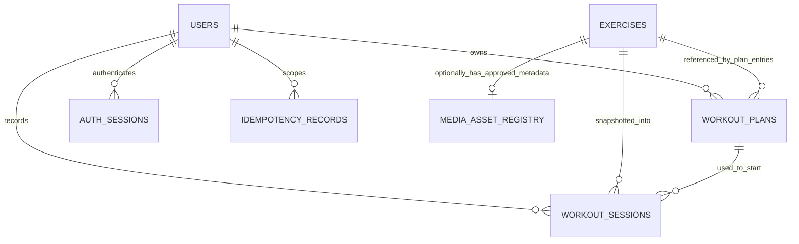

# FitTrack — MongoDB Data Model, Indexes, Migration and Integrity

> **Project:** FitTrack · **Version:** 2.0 planning baseline · **Prepared:** 2026-11-18  
> **Status:** Design/specification only; no implementation, live deployment, production security, test pass, medical accuracy review, or third-party asset license is claimed.  
> **Constraints:** 2 developers · 8-week delivery window · MongoDB, Express.js, React.js, Node.js (MERN) · responsive web app.  


## 1. Ownership and design principles
Mongoose application collections use owner-scoped queries and explicit field schemas. Internal MongoDB `_id:ObjectId` becomes lower-case 24-hex `id` for API. All timestamps persisted as UTC BSON Date and serialized ISO8601 UTC strings. Client-supplied `userId`, password hash, status, timestamps, arbitrary update operators, `$`/dot paths and raw sort pipelines are forbidden. The detailed source `ARCHITECTURE.md` §4 and `API-CONTRACT.md` govern cross-field numeric and endpoint rules.

## 2. Entity relationship model

`MEDIA_ASSET_REGISTRY` is **conceptual/offline seed-registry metadata**, not necessarily a seventh MongoDB collection in P0. Never derive database count from ERD as proof of implementation.

## 3. Collections
| Collection | Main fields | Integrity |
|---|---|---|
| `users` | `name`, `emailNormalized`, `passwordHash`, `primaryGoal`, `experienceLevel`, `equipmentPreferences`, `age?`, `heightCm?`, `currentWeightKg?` | Unique normalized email; never serialize hash |
| `exercises` | `slug`, `name`, `primaryMuscleGroup`, `secondaryMuscleGroups[]`, `equipment[]`, `difficulty`, `trackingType`, `instructions[]`, `goalTags[]`, `imageUrl?`, `animation?`, `isActive` | Unique slug; media read-only via approved seed |
| `workoutPlans` | `userId`, `name`, `description`, `days[{id,label,weekday,exercises[]}]`, `version`, `archivedAt?` | Per-user only; atomic version CAS; ≤7 days; ≤20 per day |
| `workoutSessions` | `userId`, `sourcePlanId`, `sourceDayId`, snapshot labels, `status`, `version`, `exercises[].sets[]`, start/finish times | One active per user; terminal immutable |
| `authSessions` | `tokenHash`, `userId`, `csrfState`, `expiresAt`, `revokedAt` | Server-only; revocation and expiry validated |
| `idempotencyRecords` | `userId`, `method`, `routeKey`, `key`, `payloadHash`, `state`, `responseBody`, expiry | User + method + route + key unique; TTL cleanup only |

## 4. Mongoose schema sketch (not running code)
```js
const ExerciseSchema = new Schema({
  slug: { type: String, required: true }, // unique index declared separately below
  name: { type: String, required: true },
  primaryMuscleGroup: { type: String, required: true, enum: GROUPS },
  secondaryMuscleGroups: [{ type: String, enum: GROUPS }],
  equipment: [{ type: String, enum: EQUIPMENT }],
  difficulty: { type: String, enum: ['beginner','intermediate','advanced'] },
  trackingType: { type: String, enum: ['reps_weight','reps_only','duration'] },
  instructions: [String],
  imageUrl: { type: String, default: null },
  animation: { type: Schema.Types.Mixed, default: null }, // controlled seed input ONLY; validate DTO strictly
  isActive: { type: Boolean, default: true }
}, { timestamps: true, strict: 'throw' });
```
`Schema.Types.Mixed` shown only to illustrate provenance metadata insertion; **implementation should instead define an explicit `AnimationSchema`** with allowlisted fields, enums, safe URL rules and no unsanitized public exposure. Never update document with raw `req.body`. Track per-exercise reviewed `reviewRef` in an auditable registry.

## 5. Indexes and invariants
```js
UserSchema.index({ emailNormalized: 1 }, { unique: true });
ExerciseSchema.index({ slug: 1 }, { unique: true });
ExerciseSchema.index({ isActive: 1, primaryMuscleGroup: 1, name: 1, _id: 1 });
WorkoutPlanSchema.index({ userId: 1, archivedAt: 1, updatedAt: -1, _id: 1 });
WorkoutSessionSchema.index({ userId: 1 }, {
  unique: true, partialFilterExpression: { status: 'in_progress' },
  name: 'one_active_workout_per_user'
});
WorkoutSessionSchema.index({ userId: 1, status: 1, completedAt: -1, _id: -1 });
AuthSessionSchema.index({ expiresAt: 1 }, { expireAfterSeconds: 0 });
IdempotencyRecordSchema.index({ userId: 1, method: 1, routeKey: 1, key: 1 }, { unique: true });
```
Indexes above are **specification examples**, not verification that an index exists. Verify creation/uniqueness on a real MongoDB replica set. TTL is asynchronous and must *not* substitute for request-time expiry checks.

## 6. Plan and session data semantics
- Plan days embedded and exercise references refer to curated exercise IDs. The same exercise can appear in many plans.
- Session start snapshots plan/day/exercise display names, tracking type, targets, ordered entries and dedicated performed-set IDs; future source edits do not rewrite them.
- `status`: `in_progress`, `completed`, `abandoned`. Only in-progress mutable. At least one valid performed completed set before `completed`.
- `version` compare-and-swap for plans and nested set update; stale simultaneous tabs receive 409, not silent overwrite.
- Enforce 1 active session/user with unique partial index; start operation also needs idempotency key so uncertain retry cannot duplicate resource.
- The 3D media asset is *educational metadata* on an exercise and **not** snapshotted as proof of a performed set. Historical exercise labels/values remain stable independent of a media asset revision.

## 7. Representative exact shape
```json
{
  "status": "in_progress",
  "planNameSnapshot": "4-Day Muscle Split",
  "dayLabelSnapshot": "Monday Chest",
  "version": 3,
  "exercises": [{
    "nameSnapshot": "Bench Press",
    "trackingType": "reps_weight",
    "targetReps": 10,
    "sets": [{ "position": 0, "reps": 12, "weightKg": 40, "completed": true }]
  }]
}
```
IDs/owner/timestamps omitted **for readability**; actual document must satisfy `API-CONTRACT.md` exact response shape and constraints.

## 8. Migration and seeding protocol
1. Define schema changes in a numbered migration/seed note; backup first in deployed environment.
2. Apply incompatible migrations with explicit forward/rollback plan; never quietly remove fields from completed snapshots.
3. Seed curated exercises with `slug` upserts and deterministic categories; audit after reruns.
4. Backfill optional animation metadata as `null` until rights/review verified; clients render fallback.
5. Confirm indexes exist and query planners use expected filters; test realistic dataset and two-account isolation.
6. Avoid MongoDB transaction assumptions if deployment has no replica set: W1 environment must be able to run integration transactions.

## 9. Data retention/privacy
No arbitrary personal analytics sharing. Define backup retention, user deletion/export and privacy text before a public launch; those workflows are beyond P0 unless mandated by law or institution. Minimize sensitive profile fields. Never log cookies, password hash, CSRF secret, raw request body or health details.
