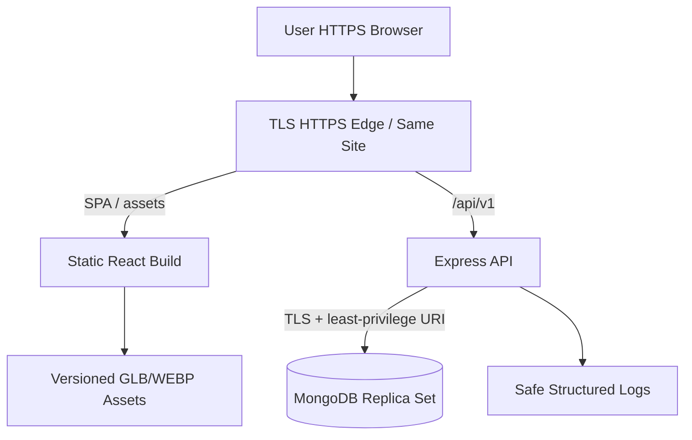

# FitTrack — Environments, Deployment, Reliability and Runbook

> **Project:** FitTrack · **Version:** 2.0 planning baseline · **Prepared:** 2026-11-18  
> **Status:** Design/specification only; no implementation, live deployment, production security, test pass, medical accuracy review, or third-party asset license is claimed.  
> **Constraints:** 2 developers · 8-week delivery window · MongoDB, Express.js, React.js, Node.js (MERN) · responsive web app.  


## 1. Architecture strategy
One React SPA built via Vite, one Node/Express modular monolith, one MongoDB replica-set-backed persistent store, static versioned 3D GLB/poster assets. HTTPS same-origin edge is preferred: `/` serves React and `/api/v1` proxies to Express. Provider not yet selected; do not claim any free tier, SLA, database uptime or successful launch.



## 2. Environment matrix
| Environment | React | Express | MongoDB | Cookies/3D media |
|---|---|---|---|---|
| Local dev | Vite local dev server | Node watch process | Local dev DB, replica-set mode for transactional tests | Local trusted origin, explicit dev cookie policy; static test assets |
| CI/integration | Built/test client | Supertest instance | Isolated seeded replica set | Stub/fixture assets for network tests; real GLB smoke separate |
| Staging | Static HTTPS | Express HTTPS proxy | Nonproduction managed replica set | Secure cookies, CSP, approved asset origins |
| Production-style release | Static HTTPS | Express behind HTTPS edge | Restricted managed replica set | Secure cookie/origin/CSRF; approved versioned public media |

## 3. Configuration and secret hygiene
Suggested `server/.env.example` **names only**:
```dotenv
NODE_ENV=development
PORT=5000
MONGODB_URI=<local-or-managed-mongodb-uri>
APP_ORIGIN=http://localhost:5173
SESSION_COOKIE_NAME=fittrack.sid
SESSION_MAX_AGE_SECONDS=604800
SESSION_TOKEN_HASH_KEY=<strong-random-secret>
CSRF_SECRET=<strong-random-secret-if-selected>
LOG_LEVEL=info
```
These are placeholders; actual auth bootstrap may introduce different configuration. Store secrets in deployment secret storage, never in `.env.example` values, version control, screenshots, React `VITE_*`, client bundles or console logs. Validate startup environment and fail closed in deployment if required secrets or trusted origins are missing.

## 4. Local reproducibility gates (commands are proposed)
```bash
# Example only — exact package scripts must be created and tested in M1.
npm install
npm run lint
npm run test
npm run build
# npm run dev:client and npm run dev:server can be provided by root scripts.
```
Document exact supported Node LTS version and verified package versions after lockfile creation. Mongoose 9 requires Node >=20.19; whether to adopt the currently supported major must be decided with Node/driver/MongoDB version tests. Do not pin an unverified major from a generic plan.

## 5. Database startup and index safety
App must connect only with scoped credentials. Ensure replica-set configuration works **before** relying on transactions. Apply unique email, slug, partial active-session and idempotency indexes before accepting writes; index-create errors must block deployment. Build upgrade plan to avoid unique conflicts in existing data. Test migration/seed twice and check category counts. DNS/TLS/connection pool/p95 should be measured after selecting actual hosting.

## 6. Release pipeline
1. Merge reviewed code to protected main; record build SHA and changelog.
2. Run lockfile integrity/dependency checks and lint, unit, API, browser and a11y suites.
3. Build SPA and Express artifact; build metadata manifest; ensure no secrets/source maps with sensitive data.
4. Validate approved model/animation registry and referenced asset hashes; upload versioned static media.
5. Back up database if release changes schema; run migration/index checks; controlled idempotent seed.
6. Deploy Express and SPA behind HTTPS, strict origins and CSP; check cache rules.
7. Run staging then live smoke: register, login, catalog, 3D or fallback, two plans, set save, refresh, complete, history, logout, cross-user ID block.
8. Record release approval and observed metrics; if smoke fails, stop exposure/rollback under reviewed compatibility plan.

## 7. Observability
Application log fields: timestamp, requestId, route template, method, status, latencyMs, high-level error code, safe environment/build ID; no password, body, personal health info, cookies, CSRF value, token, Mongo URI. Useful metrics: request rate, p50/p95 latency, 5xx frequency, DB connection/readiness, auth rejection, idempotency conflict, slow query, 3D load/error count **without identity**, static asset 404/size. `GET /api/v1/health` is liveness only; separate readiness check required to confirm DB connectivity/indexes.

## 8. Availability, recovery and backup
- On DB outage return safe 503; **never fake a successful set save**.
- On client request timeout, use resource read-back then safe retry keyed by idempotency/version policy.
- Backups should be encrypted/access controlled, regularly restored into isolated test environment; retention period and recovery targets (RPO/RTO) are TBD until hosting selected.
- 3D asset failures degrade to static posters/instructions; heavy assets never block login or workout logging.
- A real public launch requires actual privacy/retention decisions, secure secrets and incident handling, not just a semester demo.

## 9. Rollback and compatibility
Rollback of frontend/media is straightforward when assets are content-versioned, but database migrations require forward/backward compatibility review. Never delete historical session fields or mutate terminal snapshots as a rollback shortcut. Monitor for expired cookies, CORS/CSRF failures and GLB 404s after release. Document a rollback command **only after actual hosting and CI are chosen**.

## 10. Completion evidence template
```
Release ID: TBD
Commit: TBD
HTTPS URL: TBD
Database indexes verified: NOT RUN
Migrations/seed log: NOT RUN
CSRF/cookie audit: NOT RUN
3D licensed asset check: NOT RUN
E2E smoke test: NOT RUN
Accessibility test: NOT RUN
Rollback drill: NOT RUN
Approvers: TBD
```
