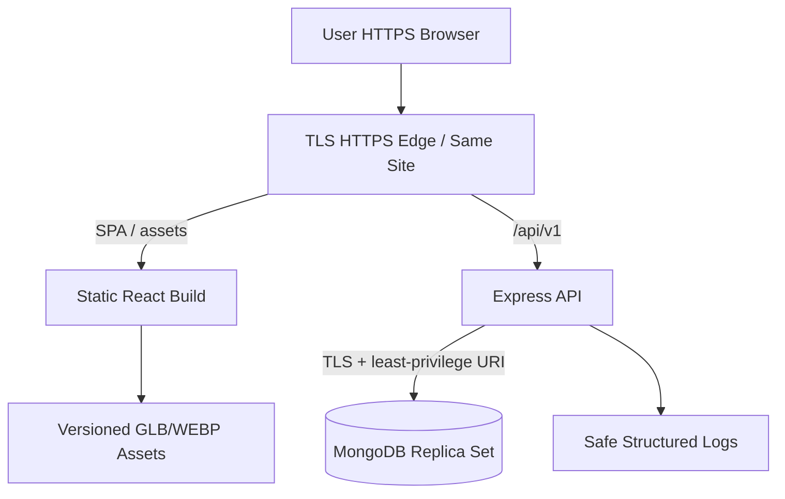

# FitTrack — Environments, Deployment, Reliability and Runbook

> **Project:** FitTrack · **Version:** 2.1 deployment handoff · **Prepared:** 2026-11-18
> **Status:** Provider-neutral deployment preparation is implemented and locally verified. The user selected Vercel for the SPA and Render for the API, but no projects, public origin, production database, or live deployment are configured or verified. The reviewed 3D asset release gate remains blocked.
> **Constraints:** 2 developers · 8-week delivery window · MongoDB, Express.js, React.js, Node.js (MERN) · responsive web app.  


## 1. Architecture strategy
One React SPA built via Vite, one Node/Express modular monolith, one MongoDB replica-set-backed persistent store, static versioned 3D GLB/poster assets. The selected topology is a Vercel SPA with `/api/v1` proxied to a Render API so session cookies remain same-origin; the Render `APP_ORIGIN` must exactly match the Vercel production origin. No projects or service URLs have been provisioned. Do not claim any free tier, SLA, database uptime or successful launch. The API bind address is configured by `HOST` (default `127.0.0.1`); Render must bind to its required public/container interface.



## 2. Environment matrix
| Environment | React | Express | MongoDB | Cookies/3D media |
|---|---|---|---|---|
| Local dev | Vite local dev server | Node watch process | Local dev DB, replica-set mode for transactional tests | Local trusted origin, explicit dev cookie policy; static test assets |
| CI/integration | Built/test client | Supertest instance | Isolated seeded replica set | Stub/fixture assets for network tests; real GLB smoke separate |
| Staging | Static HTTPS | Express HTTPS proxy | Nonproduction managed replica set | Secure cookies, CSP, approved asset origins |
| Production-style release | Static HTTPS | Express behind HTTPS edge | Restricted managed replica set | Secure cookie/origin/CSRF; approved versioned public media |

## 3. Configuration and secret hygiene
The root `.env.example` and `server/src/config/env.js` define the current runtime configuration:
```dotenv
NODE_ENV=production
HOST=0.0.0.0
PORT=<platform-assigned-port>
MONGODB_URI=<private-mongodb-uri>
APP_ORIGIN=https://<public-app-origin>
AUTH_HMAC_SECRET=<private-random-secret-of-at-least-32-characters>
TRUST_PROXY_HOPS=<exact-trusted-proxy-hop-count>
```
`HOST` defaults to loopback and accepts an IPv4 or IPv6 address. `TRUST_PROXY_HOPS` defaults to `0`; set it only to the exact number of trusted proxies in the chosen topology. The API validates the production HTTPS origin and a non-placeholder HMAC secret. Store `MONGODB_URI` and `AUTH_HMAC_SECRET` in deployment secret storage; never place them in source control, screenshots, React `VITE_*` variables, client bundles, or console logs. Never paste credentials into chat. Rotate any credential previously exposed outside private secret storage.

## 4. Reproducibility and deployment smoke checks
Run from the repository root with the documented Node/npm versions:
```powershell
npm ci
npm test
npm run test:auth
npm run test:exercises
npm run test:plans
npm run test:sessions
npm run test:analytics
npm run test:db
npm run test:deployment-smoke
npm run build
```
`npm run test:db` uses an ephemeral MongoDB replica set; it does not verify access to a managed production database. The root `start` script starts the API only. The selected hosting edge must serve `client/dist` and proxy `/api/v1` to the API over the same HTTPS origin.

The read-only deployment smoke command checks the SPA root, API liveness, API readiness, and that an anonymous request to the private session endpoint is rejected:
```powershell
$env:FITTRACK_DEPLOYMENT_URL = "https://<public-app-origin>"
npm run smoke:deployment
```
For a local Vite preview, HTTP is allowed only on loopback. The command performs GET requests only; it creates no accounts or workout records and requires no production credentials.

## 5. Database startup and index safety
The API connects with `MONGODB_URI` before listening and awaits Mongoose initialization for every registered model, including its declared indexes. Index creation failures therefore block startup rather than allowing writes against an unprepared database. Critical indexes include unique user email, the partial one-active-session index, idempotency uniqueness/TTL, and session TTL. The integration test verifies these against an ephemeral replica set. This is not a migration system: review index changes and existing-data conflicts before production rollout, use appropriately scoped credentials, and test any seed/migration twice. Replica-set configuration is required for transactional features. DNS/TLS, connection pool behavior, and p95 latency remain unmeasured until the selected platform projects and production database are provisioned.

## 6. Release pipeline
The application has no provider-specific deployment pipeline yet. Before a real release:
1. Provision/link the Render API and Vercel SPA projects; determine their exact production origins, MongoDB deployment, trusted-proxy topology, and secret-storage mechanism.
2. Run lockfile integrity, automated tests, production build, and the required accessibility/cross-browser checks.
3. Verify approved model/animation rights and movement review; the current 3D release gate is not cleared.
4. Back up production data before schema/index changes; review index conflicts and any controlled idempotent seed.
5. Deploy the API and SPA behind HTTPS with Vercel same-origin `/api/v1` proxying to Render, secure cookies, strict origins, and reviewed cache/CSP rules.
6. Run `npm run smoke:deployment`, then the authenticated staging scenarios in the QA plan using non-production accounts.
7. Record the build SHA, observed results, approval, and provider-specific rollback procedure. Do not label the release complete when any gate has not run.

## 7. Observability
Application log fields: timestamp, requestId, route template, method, status, latencyMs, high-level error code, safe environment/build ID; no password, body, personal health info, cookies, CSRF value, token, Mongo URI. Useful metrics: request rate, p50/p95 latency, 5xx frequency, DB connection/readiness, auth rejection, idempotency conflict, slow query, 3D load/error count **without identity**, static asset 404/size. `GET /api/v1/health` is liveness; `GET /api/v1/ready` reports database connectivity. Since index initialization completes before the listener starts, a live process has also passed its startup index initialization, but readiness does not independently re-audit indexes.

## 8. Availability, recovery and backup
- On DB outage return safe 503; **never fake a successful set save**.
- On client request timeout, use resource read-back then safe retry keyed by idempotency/version policy.
- Backups should be encrypted/access controlled, regularly restored into isolated test environment; retention period and recovery targets (RPO/RTO) are TBD until hosting selected.
- 3D asset failures degrade to static posters/instructions; heavy assets never block login or workout logging.
- A real public launch requires actual privacy/retention decisions, secure secrets and incident handling, not just a semester demo.

## 9. Rollback and compatibility
Rollback of frontend/media is straightforward when assets are content-versioned, but database migrations require forward/backward compatibility review. Never delete historical session fields or mutate terminal snapshots as a rollback shortcut. Monitor for expired cookies, CORS/CSRF failures and GLB 404s after release. Document a rollback command **only after actual hosting and CI are chosen**.

## 10. Completion evidence template
```
Release ID: TBD
Commit: TBD
HTTPS URL: TBD
Database indexes verified: ephemeral replica-set integration test only; production NOT RUN
Migrations/seed log: NOT RUN
CSRF/cookie audit: NOT RUN
3D licensed asset check: NOT RUN
Read-only deployment smoke: locally testable; deployed URL NOT PROVIDED
Authenticated staging E2E: NOT RUN
Accessibility test: NOT RUN
Rollback drill: NOT RUN
Approvers: TBD
```
