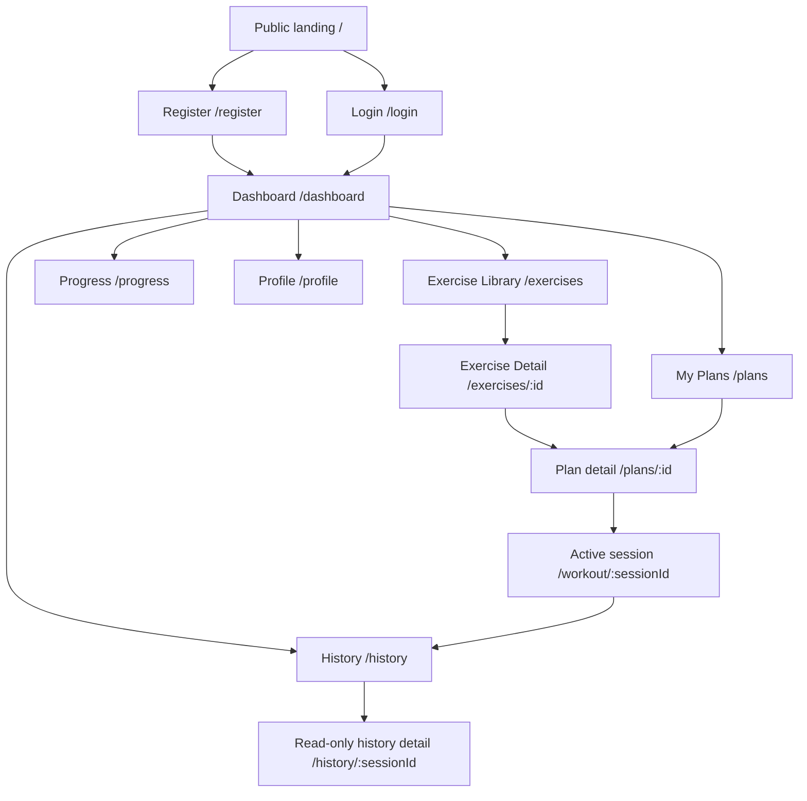

# FitTrack — UI/UX and Interaction Specification

> **Project:** FitTrack · **Version:** 2.0 planning baseline · **Prepared:** 2026-11-18  
> **Status:** Design/specification only; no implementation, live deployment, production security, test pass, medical accuracy review, or third-party asset license is claimed.  
> **Constraints:** 2 developers · 8-week delivery window · MongoDB, Express.js, React.js, Node.js (MERN) · responsive web app.  


## 1. Scope and authority
This document is authoritative for screen-level UX and public landing structure. `REQUIREMENTS.md` governs mandatory behavior and accessibility; `API-CONTRACT.md` governs payloads; `official-theme.md` governs tokens. The user's supplied Looponics screenshot is **layout inspiration** for dramatic typographic scale and a viewport-height end section—not a request to duplicate its name, email, assets, navigation, or design.

## 2. Information architecture


All private routes are guarded **in UI and API**. `GET /api/v1/auth/session` is the hydration source. `/workout/:sessionId` is not a plan ID.

## 3. Public landing — exact blueprint
### 3.1 Header
Transparent or dark ocean/nav surface over hero; left FitTrack logotype; anchor links Features, Exercise Library, 3D Demonstrations, Progress, How It Works; right Login and Get Started. On narrow widths, accessible menu button/drawer, Escape support, focus management and navigation labels. Sticky header only if contrast and layout permit; never obscure hero CTA.

### 3.2 HERO — full-page first screen
**`min-height: 100svh; min-height: 100dvh` with 100vh fallback**, not rigid height that crops content. The hero includes/compensates for the navbar so *first visible screen feels full-page*. On tiny screens allow vertical growth and scroll.

- Kicker: `PERSONAL WORKOUT TRACKER`.
- Heading: `Build Your Plan. Track Every Set. Own Your Progress.` (proposed copy).
- Supporting copy: `Explore exercises, watch validated 3D demonstrations, log real workouts, and understand your training history.`
- Primary CTA: **Get Started** -> `/register`; secondary: **Explore Features** -> `#features`.
- Visual: licensed realistic anatomical 3D human, consciously controlled idle animation (no constant motion required), static fallback for unsupported/reduced-motion browsers, optional restrained muscle highlight only if the actual mesh supports reviewed regions.
- **No fabricated user statistics.** Feature cards may show `Workout Planning`, `3D Demos`, `Verified History`, but not unsupported counts of users/achievements.
- Visual direction: generous negative space, large Manrope typography, deep ocean field, Amber Glow CTA, subdued turquoise rim light, no copied branding from reference screenshot.

Desktop: editorial two-column hero, text readable first, 3D in secondary visual column. Mobile: content and CTA before 3D; do not make a giant WebGL canvas the initial blocking load. Primary CTA visible without requiring a scroll whenever practical.

### 3.3 Middle narrative sections (variable natural height)
1. **Why FitTrack?** — real user pain / succinct outcomes.
2. **Feature grid** — plans, log performed sets, exercise discovery, history, progress.
3. **3D Exercise Showcase** — verified movement viewer; source/technique reviewed badges only when evidence exists; no fake interactivity.
4. **Exercise Discovery Preview** — sample category tiles, public explanatory content only; private API does not accidentally leak catalog unless policy is changed.
5. **Progress Analytics Preview** — fully labeled **illustrative sample** graph; never suggest it comes from a visitor's saved data.
6. **How It Works** — Register -> Plan -> Log -> Review (4 steps).
7. **Accessibility/Device Section** — mobile usability, reduced motion, readable measurement units.

Middle content alternates illustration/text orientation or feature/card layout. Avoid arbitrary scroll-jacking, forced snap points, or content hidden behind cinematic transitions.

### 3.4 OUTRO/FINAL CTA — full-page closing screen
**`min-height: 100dvh` (with appropriate fallbacks)**, headline `Make Every Workout Count.`; brief copy; `Create Your Account` -> `/register`; `Already have an account? Log In` -> `/login`. Large restrained `FITTRACK` typographic background wordmark with low opacity; **footer integrated within this same viewport-height closing section** and allowed to expand naturally on small screens. Footer contains only real routes/contact if supplied; never invent team emails, social accounts, terms or legal promises. Footer nav: About/Features/Privacy (latter only if page actually exists) and technical/legal links conditional on implementation.

```
[ HERO: min-height full viewport + navigation ]
[ Why FitTrack: natural height ]
[ Core Features: natural height ]
[ 3D Demonstration: natural height ]
[ Discovery Preview: natural height ]
[ Progress Preview: natural height ]
[ How It Works: natural height ]
[ OUTRO: min-height full viewport + footer contained inside ]
```

## 4. Protected application screens
| Route | Sections and states | Primary action |
|---|---|---|
| `/register` | Name/email/password, safe validation, duplicates, pending/error | Create account |
| `/login` | Email/password, generic invalid credentials, session hydration | Sign in |
| `/dashboard` | Goal, plans, active session resume, recent completed history, stats and empty state | Resume or start from plan |
| `/exercises` | Search, group chips, equipment/difficulty filters, count and clear all, real paginated data | View exercise |
| `/exercises/:id` | Name, muscles, equipment, instructions, optional reviewed 3D viewer/poster, add-to-plan picker | Add to plan |
| `/plans` | Owned plan cards, create, archive confirm | Create plan |
| `/plans/:id` | Name, 1–7 days, exercise picker, ordered entries, reps/seconds/load, version conflict UX | Save and start day |
| `/workout/:sessionId` | Snapshot, set rows, reps/weight or duration, statuses, resume, finish/abandon | Save set / Complete |
| `/history` | Paginated completed list, newest first, empty state | View details |
| `/history/:sessionId` | Read-only immutable session snapshot | Return to history |
| `/progress` | Weekly completion trend, exercise history, units/range and table alternative | Inspect trend |
| `/profile` | Goal, level, equipment, optional age/height/current weight, saved/error | Save profile |
| `*` | Friendly 404 | Return home |

## 5. Component inventory
`AppShell`, `Navbar`, `Footer`, `Sidebar`, `MobileNav`, `Button`, `LinkButton`, `TextField`, `Select`, `FilterChip`, `Dialog`, `Toast`, `Skeleton`, `EmptyState`, `ErrorState`, `StatCard`, `ExerciseCard`, `ExerciseViewer3D`, `ExerciseInstructionList`, `PlanDayEditor`, `ExercisePicker`, `SetRow`, `WorkoutSaveStatus`, `ChartPanel`, `ChartTableEquivalent`.

Components must be reusable and keyboard-aware. Route-bound fetches have loading, empty and error states; write operations have pending, success, conflict and retry. Do not show 'Saved' until a 2xx API response confirms the current edit (or refetch verifies it).

## 6. 3D viewer interaction contract
- Show a poster/skeleton until asset is explicitly requested/ready; do not block page content with WebGL loading.
- If clip status `verified`, enable play, pause, replay and speed 0.5×/1×/1.5×; default user-control, reduced motion default pause.
- Camera drag/orbit must have accessible alternative or disable orbit in MVP; do not rely on drag-only action.
- `loading`/`unsupported`/`missing`/`error`/`ready` statuses have visible messages; instructions stay readable.
- Do not assert exact biomechanical accuracy or muscle activation without external review evidence. On missing clip fallback to accessible poster/short instructions.
- Respect memory/perf budgets from `3D-ANIMATION-SYSTEM.md`; unload off-screen heavy content and dispose graphics resources.

## 7. Workout logging: highest priority form
Touch-friendly rows, minimum 44px buttons, numeric keyboard hints and visible units; per-row completion toggles. Temporary empty values while typing allowed; validation on save. Display last server-confirmed values, local dirty edits, saving spinner and retry warnings without silently dropping inputs. Changing session state (complete/abandon) requires clear confirmation and API success; alternate tab stale versions return refetch/reconcile prompt.

## 8. Graph design
All production graphs use API data and explicit date windows. Chart shows title, x/y axis, unit, hovered/tapped label, empty state, accessible text/table equivalent. Color alone cannot distinguish series; labels and markers required. Intro landing graphs can be illustrative, clearly labeled.

## 9. Accessibility, responsive and motion acceptance
- Width matrix: 320, 360, 375, 768, 1024, 1440px; 200% zoom and landscape.
- Visible focus, keyboard Tab order, semantic nav/main/footer, `aria-current`, semantic forms, status messages, dialog focus restoration.
- Reduced motion: no auto-moving anatomical model; static fallback available; no scroll-jacking.
- Contrast: WCAG 2.2 AA target; verify actual final foreground/background; 3D is supplemental to instructions.
- Header and CTA never overlap viewport or safe-area insets; 100vh is **minimum** not fixed card height.

## 10. UI design QA checklist
- [ ] Hero and outro visibly fill tall desktop viewport without blank strip and with footer integrated in outro.
- [ ] Small mobile landing allows content to expand rather than clip.
- [ ] Ocean Breeze semantic tokens and Manrope applied with justified fallback.
- [ ] Protected routes reject unauthenticated state; no API data leaks.
- [ ] Workout form no horizontal scrolling or false saved state.
- [ ] 3D viewer passes fallback and reduced-motion tests.
- [ ] Chart contains genuine units and text equivalents.
- [ ] No copied Looponics assets, wordmark, navigation labels or external contact details.
