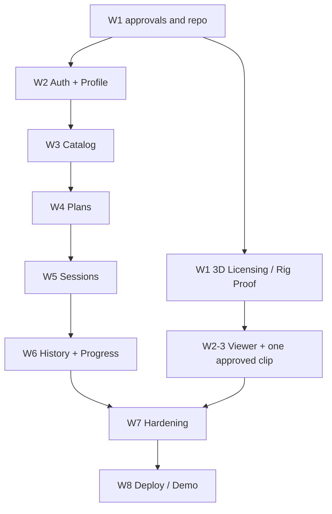

# FitTrack — Eight-Week Execution Plan and Work Breakdown Structure

> **Project:** FitTrack · **Version:** 2.0 planning baseline · **Prepared:** 2026-11-18  
> **Status:** Design/specification only; no implementation, live deployment, production security, test pass, medical accuracy review, or third-party asset license is claimed.  
> **Constraints:** 2 developers · 8-week delivery window · MongoDB, Express.js, React.js, Node.js (MERN) · responsive web app.  

## 1. Planning constraints
2 developers, 8 relative weeks, fixed MERN core. Developer A focuses frontend/3D/UX, Developer B backend/data, both jointly own integration/security/test/deployment. Actual work hours, start date, holiday calendar and final evaluation date are TBD. The user wants full-scale scalability, but **P0 release inventory is bounded** (32+ exercises, 1 verified 3D clip, complete workout core). Proposed W1 capacity: 2 × 20–25 h/week = 40–50 team-hours, not a promise.

## 2. Critical path and parallel 3D workstream

## 3. Week-by-week delivery board
| Week | Developer A (UI/3D) | Developer B (API/Data) | Joint checkpoint / exit evidence |
|---|---|---|---|
| W1 | Brand shell, navbar, 3D GLB proof, landing structure | Repo/Express/DB connection, indexes/dev replica-set proof, CI conventions | API health + React shell; 3D licensing and motion feasibility evidence |
| W2 | Landing hero/outro complete, auth/profile forms, accessible menu and reduced motion | User schema, session/CSRF login/logout/profile API, auth tests | End-to-end register/login/profile; no fake UI states |
| W3 | Catalog search/cards/detail, initial anatomical viewer controls/fallback | Seed 32+, catalog search/filter/detail and media metadata DTO | Counts proof; filter combinations; 3D approved clip if rights/review ready |
| W4 | Plans list/editor, exercise picker/day prescriptions/version conflict UX | Plans CRUD, nested validation, stable IDs, archive, idempotent create | Two plans persist separately; unauthorized access blocked |
| W5 | Active workout set logger, save state, resume, finish/abandon dialogs | Snapshot/session state machine, CAS set updates, unique active index, completion | Real save-refresh-resume, racing-tab, immutable session tests |
| W6 | History list/details, charts/table equivalents, profile polish | Completed-only analytics, time boundary, progress summary, pagination | 3× actual sets = 1330 kg·reps; real history/dashboard reconcile |
| W7 | Responsive/accessibility/mobile QA, 3D fallback optimization, extra clips **only if ready** | Security negative tests, performance queries/index audit, failure/retry tests | High-risk defects closed; E2E and manual a11y logs |
| W8 | UI cleanup, final screenshots, demo sequence | Deploy HTTPS/env, seed production, restore/smoke tests, handoff | Released/verified only with actual evidence; publish final report/demo |

## 4. Work item taxonomy and evidence
Each issue includes ID (`FT-W5-SES-03`), requirement links, owner, branch/PR, estimated hours, dependencies, definition of done, test reference, decision link, risk and actual status. Use statuses `Backlog -> Ready -> In Progress -> Review -> Verified -> Done` with `Blocked` explicit. A PR may merge only after the other developer reviews high-risk code; commit `.env.example`, not secrets.

## 5. Week 1 decision gates
| Gate | Required decision before work | Current state |
|---|---|---|
| W1-A | Approved supporting React 3D libraries | Proposed / permission TBD |
| W1-B | Local Mongoose/MongoDB version matrix and replica set | Proposed / setup TBD |
| W1-C | Auth cookie design + exact pre-auth CSRF bootstrap | Proposed / must approve before W2 |
| W1-D | One model + animation license, rig, anatomy reviewer | Unknown / proof required |
| W1-E | Error envelope, validation library, test scripts, CI | Proposed / approve |
| W1-F | Developer names, working time, final deadline | Unknown / record when supplied |

## 6. Cutline and fallback strategy
- If W1 3D proof fails, record blocker and prioritize real workout core. **Do not call P0 done without an accepted change request redefining the 3D criterion.**
- If W3 expanded catalog slips, ship 32 carefully reviewed records, not empty placeholders.
- If W5 concurrency/session tests fail, pause new graphs/animations until reliability is restored.
- If W7 blockers remain, do not claim production security, accessibility or performance acceptance.
- No new features after W6 unless high-priority blocker or critical fix; freeze W7 for quality and W8 for release.

## 7. Test ownership
Developer A owns RTL/Playwright browser interactions, 3D playback/fallback/responsive tests. Developer B owns Supertest API/security/data fixtures/transaction integration. Both review E2E happy path and multi-account privacy tests. A negative test is required for every sensitive write.

## 8. Delivery artifacts and percentage of completeness
Code, architecture docs, SRS, API examples, schema/index proof, asset-license register, design screenshots, math test fixtures, threat review, accessibility notes, test report, installed dependencies/lockfiles, deployment guide, demo account plan. Status is never a subjective '90% done': mark each P0 gate passed, failed or blocked with evidence.

## 9. Milestone exit gates
| Checkpoint | Required working proof |
|---|---|
| W2 | Two user accounts, login/session/logout, private profile |
| W3 | 32+ seed, 8 groups, filters, detail, media fallback and 3D proof |
| W4 | Two plans, valid nested edits, archive retains links |
| W5 | Saved performed sets survive refresh, one-active index tested |
| W6 | Historical truth, reproducible aggregate values, no fabricated stats |
| W7 | Automated suites plus keyboard/mobile/security negative report |
| W8 | Built app, deploy smoke test, release audit and repeatable demo |
