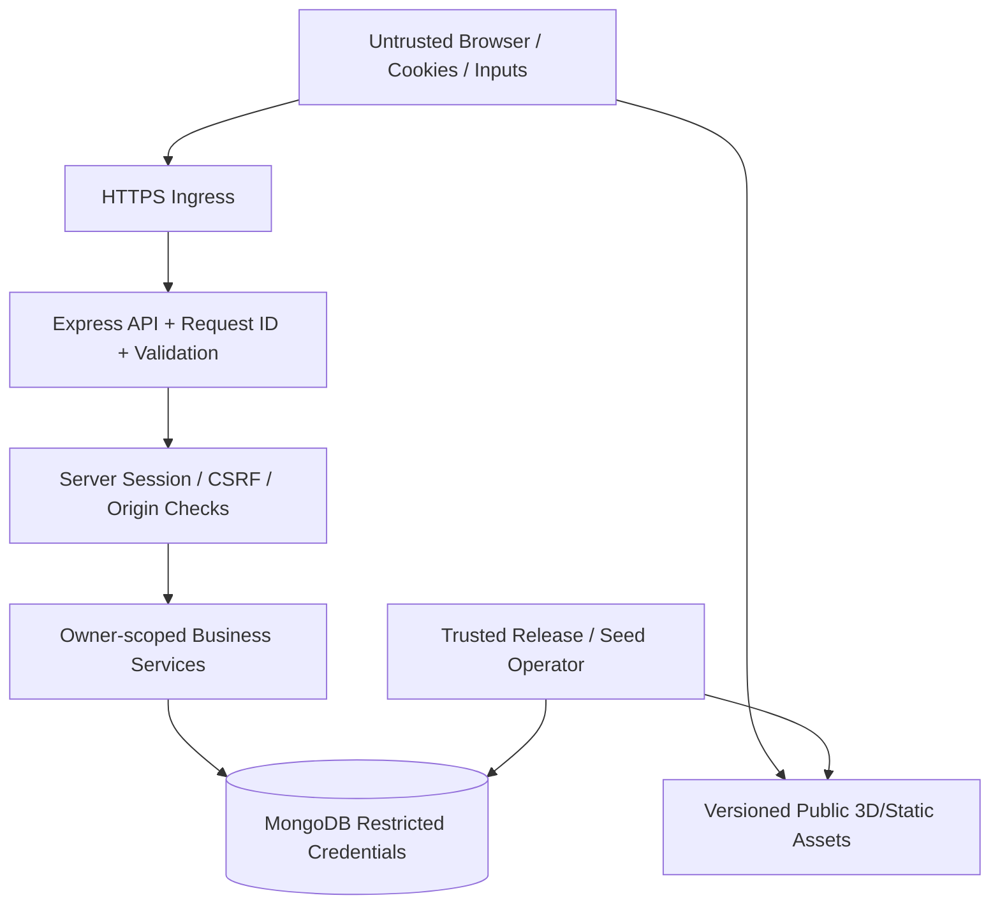

# FitTrack — Threat Model, Security and Privacy Engineering Standard

> **Project:** FitTrack · **Version:** 2.0 planning baseline · **Prepared:** 2026-11-18  
> **Status:** Design/specification only; no implementation, live deployment, production security, test pass, medical accuracy review, or third-party asset license is claimed.  
> **Constraints:** 2 developers · 8-week delivery window · MongoDB, Express.js, React.js, Node.js (MERN) · responsive web app.  

## 1. Security posture and source standard
Threat model design aims to follow relevant **OWASP ASVS 5.0** requirements and OWASP guidance; no claim of audited conformance. Reference: https://asvs.owasp.org/. Only the authenticated user's workout/profile data may be retrieved or altered. The exercise catalog is shared read-only and authenticated in v1; public landing is static. No untrusted client input can assign `userId` or set 3D media review state.

## 2. Trust boundary map

## 3. Threat / control matrix
| Threat | Impact | Control and required test |
|---|---|---|
| Cross-user object ID request | User data leakage | Every private DB filter includes `{_id,userId}`; non-owner safe 404 test |
| Credential stuffing | Unauthorized account | Rate-limit login/register, generic auth errors, log safe metadata |
| Password theft | Account takeover | Argon2id preferred or configured bcrypt; never plaintext; secrets not logged |
| Session theft/fixation | Unauthorized access | Cryptographically random opaque token, rotate on login, store token hash, HttpOnly Secure cookie |
| Cross-site request forgery | Mutations via cookie | CSRF token plus exact Origin checks and SameSite; pre-auth bootstrap defined/tested |
| NoSQL operator injection | Data tamper/leak | Explicit validation allowlists, reject dotted keys and raw Mongo operators |
| XSS via exercise/instruction data | Session/data theft | Render escaped text, no arbitrary HTML, CSP, safe URLs |
| Uploaded malicious 3D/media URL | Supply-chain/XSS/DoS | No user media upload in P0; trusted seed only; verify origin/MIME/file/license |
| Public cached private API | Data leakage | `Cache-Control: private,no-store`; prohibit sharing user IDs in media URLs |
| Duplicate/multi-tab writes | Incorrect history | Unique one-active index, CAS `version`, idempotency records, atomic transitions |
| Secrets in logs or client | DB/cookie compromise | Strict env separation, redact cookies/passwords/tokens; test build bundles |
| Dependency compromise | Execution / exfiltration | Lockfile, pinned versions, audit, source/license review, upgrades with tests |
| Exhaustive queries | Availability | Query whitelist, max page=10000, limit ≤50, request size cap, rate limits |

## 4. Authentication proposal — ratify TD-01 before W2
- One server-managed **opaque, revocable session token** in cookie `fittrack.sid` (`HttpOnly`, `Secure` in production, `SameSite=Lax`, `Path=/`, scoped Max-Age); token hash in MongoDB store, fixed expiry and revocation checks at every request.
- Proposed lifetime **7 days absolute**, not an approved default until owner signs TD-01. Rotate on login; revoke + clear on logout; logout is not merely removing React state.
- State-changing cookie-auth requests require CSRF double-defense: issued CSRF token bound to session and allowlisted `Origin`/`Referer` policy. Pre-auth registration/login bootstrap must be decided and tested rather than omitted.
- Production same-origin reverse proxy for React static files + `/api/v1` preferred. Strict credentialed CORS allowlist when cross-origin deployment unavoidable; no wildcard with credentials.
- `GET /auth/session` returns safe user summary; cookie secret/session ID never exposed in JSON/localStorage.

## 5. Password policy and account errors
Hash with Argon2id or suitably configured bcrypt (pending library decision). Strong password rules and rate limiting. `emailNormalized` unique. Duplicate registration may disclose known-email conflict because SRS requires explicit response; login always generic invalid-credentials. No password reset email in P0; do not show a fake 'Forgot Password' flow.

## 6. Authorization matrix
| Endpoint/resource | Visitor | Owner | Other signed-in user |
|---|---|---|---|
| Landing and auth bootstrap | Public where specified | Public where meaningful | Same |
| Exercise catalog | 401 in P0 | Read only | Read only |
| Profile | 401 | Own read/update | No other-profile endpoint |
| Plans | 401 | CRUD/soft archive own | Safe 404 |
| Sessions/history | 401 | Own state-compliant reads/writes | Safe 404 |
| Dashboard/progress | 401 | Own | No cross-user resource |
| Publish exercise animation | Not available | Not available | Not available |

## 7. Browser and media security
Implement appropriate HTTP security headers (Helmet or equivalent, CSP carefully tested with 3D WebGL and static assets, MIME sniffing restrictions, HSTS in real HTTPS production, Referrer-Policy). Configure `connect-src`, `img-src`, `font-src`, and where relevant `worker-src` only for documented origins. Avoid unsafe-inline scripts and untrusted remote shaders. Validate fetched glTF external buffers/textures or favor self-contained `.glb` with versioned approved assets. Never eval media metadata. On a public file host, static model files are publicly retrievable; do not place confidential data in model/filename.

## 8. Privacy design
Minimize health-like profile data; optional fields can be null; no unnecessary IDs or identifiers in telemetry. User profile and workout history are personal data. Privacy statement and user consent/rights need review before public usage; exercise content is informational. Backups must be access restricted; logs exclude raw health profile fields. Account deletion/export is P1, but any real-world legal compliance duties must be reviewed separately and cannot be waived by P1 labeling.

## 9. Incident and operations
Record request ID, route template, status, error code, latency; avoid credentials, cookie content, session/CSRF values and full workout payload. For compromise, revoke sessions, rotate secrets, audit logs and communicate according to applicable requirements. Backups and restore must be tested before storing user data in a real release environment.

## 10. Verification requirements
- Cookie has correct flags and is rotated/revoked; old cookie fails after logout.
- CSRF missing/invalid and foreign Origin rejected on mutation.
- Two-account resource ID enumeration does not leak data.
- Invalid JSON, NoSQL selectors, huge request and numeric boundaries fail safely.
- No private data in public `GET /health`, media, source maps, cached JSON or frontend bundle.
- Media license/approval cannot be set by ordinary API.
- Dependency/security audit findings documented with remediations; zero known critical unmitigated defects at release.
