# FitTrack — Architecture Diagram Collection (Mermaid Sources)

> **Project:** FitTrack · **Version:** 2.0 planning baseline · **Prepared:** 2026-11-18  
> **Status:** Design/specification only; no implementation, live deployment, production security, test pass, medical accuracy review, or third-party asset license is claimed.  
> **Constraints:** 2 developers · 8-week delivery window · MongoDB, Express.js, React.js, Node.js (MERN) · responsive web app.  

> All diagrams are **conceptual design**, not evidence of runtime infrastructure or built files. Mermaid source is maintained here to make the designs editable and reproducible in VS Code / Markdown preview tooling. The canonical API/data contracts remain in `API-CONTRACT.md` and `DATABASE-SCHEMA.md`.

## 1. C4-inspired context diagram
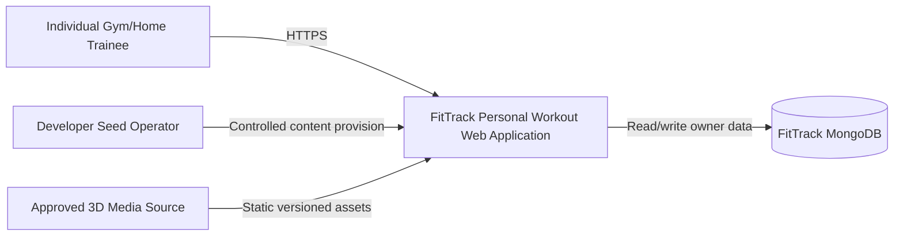

## 2. Container architecture
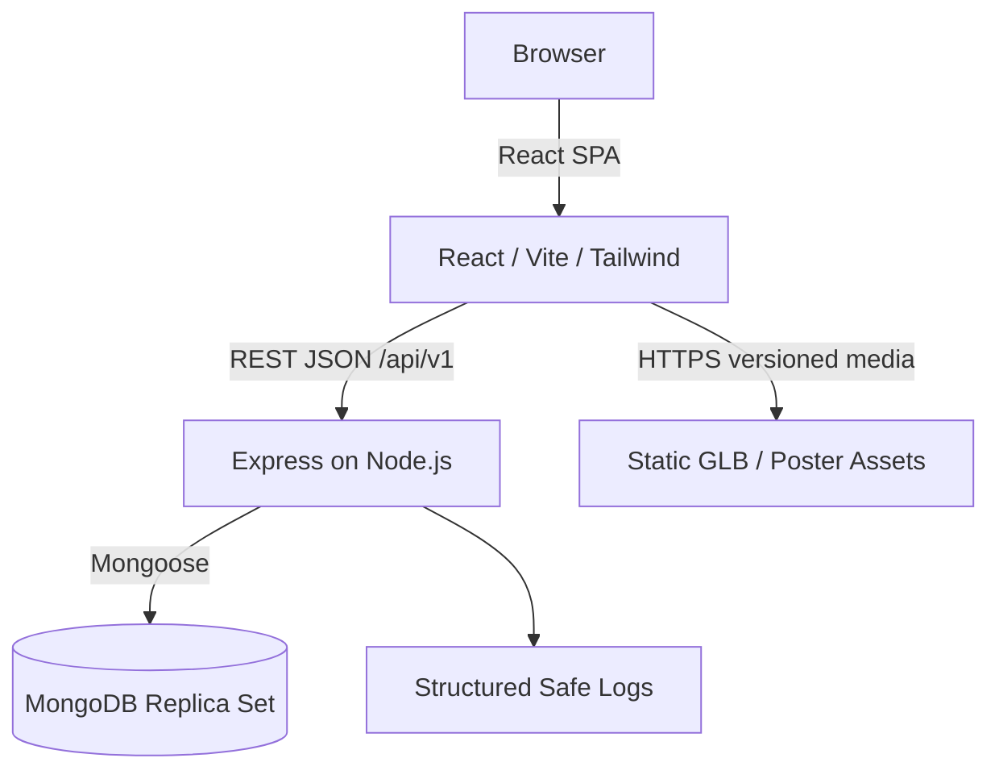

## 3. Express component diagram
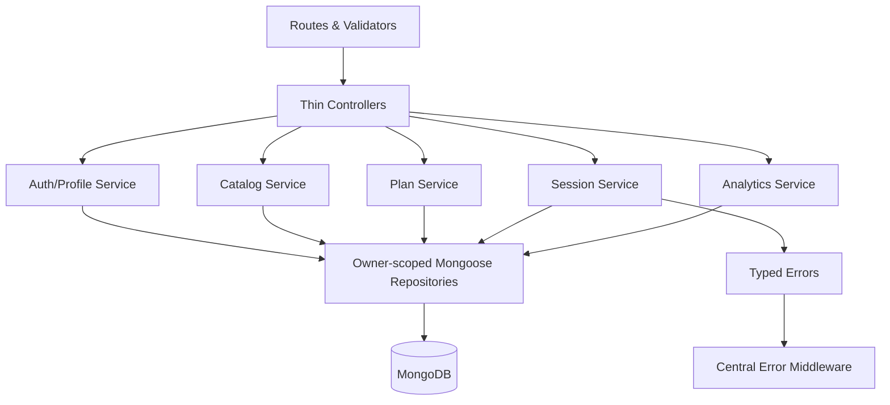

## 4. UML-style use cases
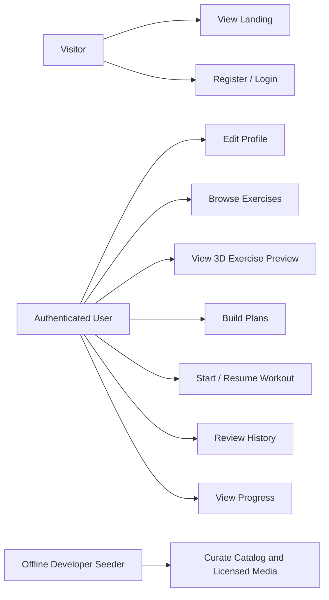

## 5. DFD level 0 (high-level flows)
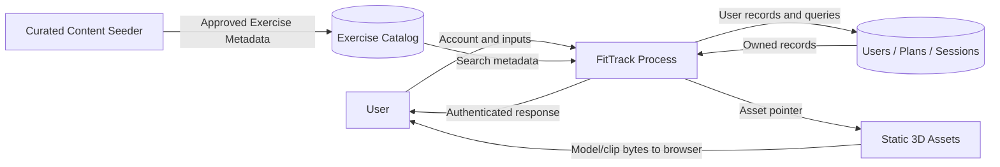

## 6. DFD level 1 — workout persistence
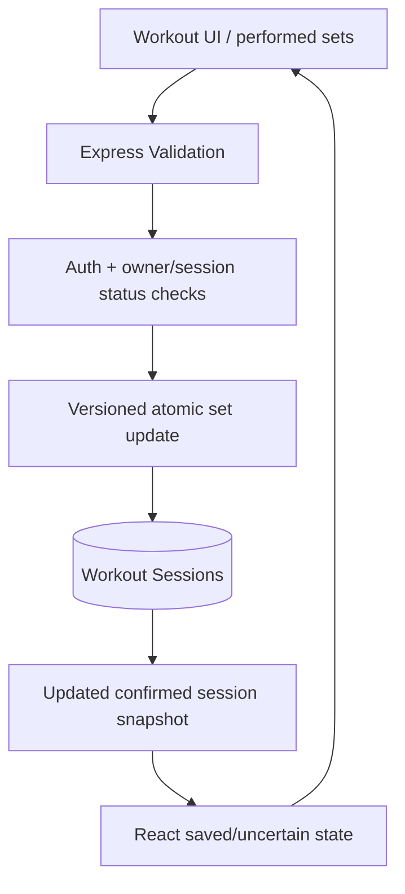

## 7. Sequence — register and hydrate
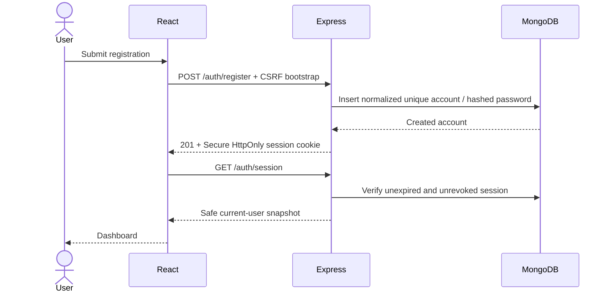

## 8. Sequence — plan to completed immutable workout
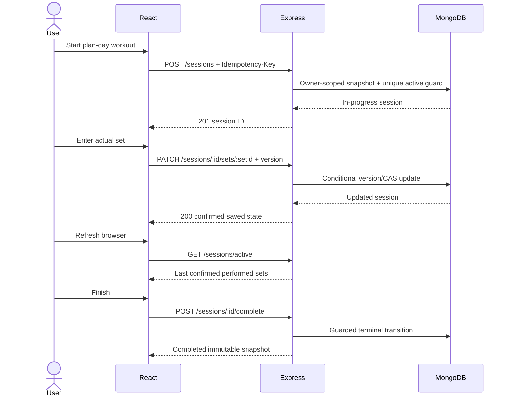

## 9. Sequence — 3D asset loading and fallback
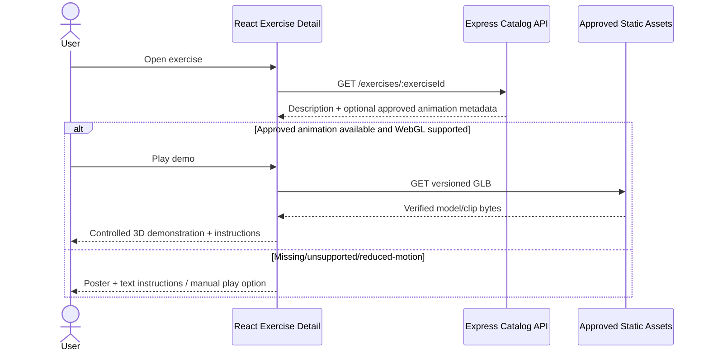

## 10. Workout lifecycle state machine
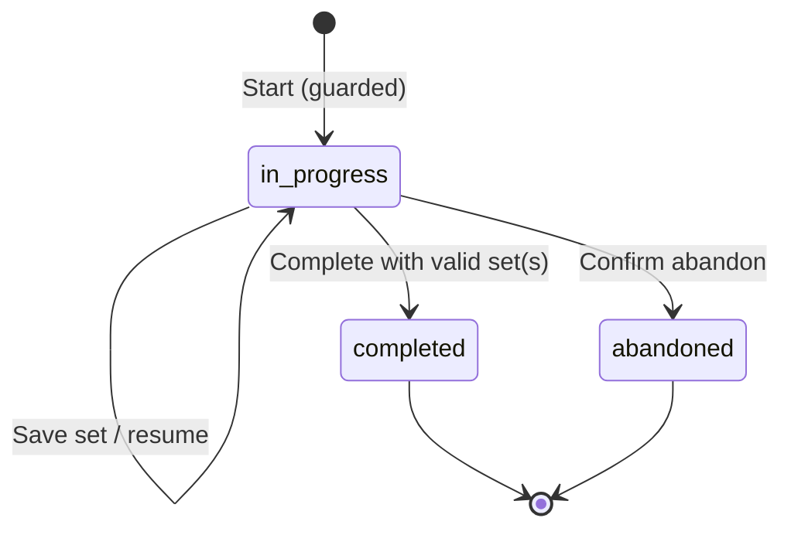

## 11. Data ownership and cardinality
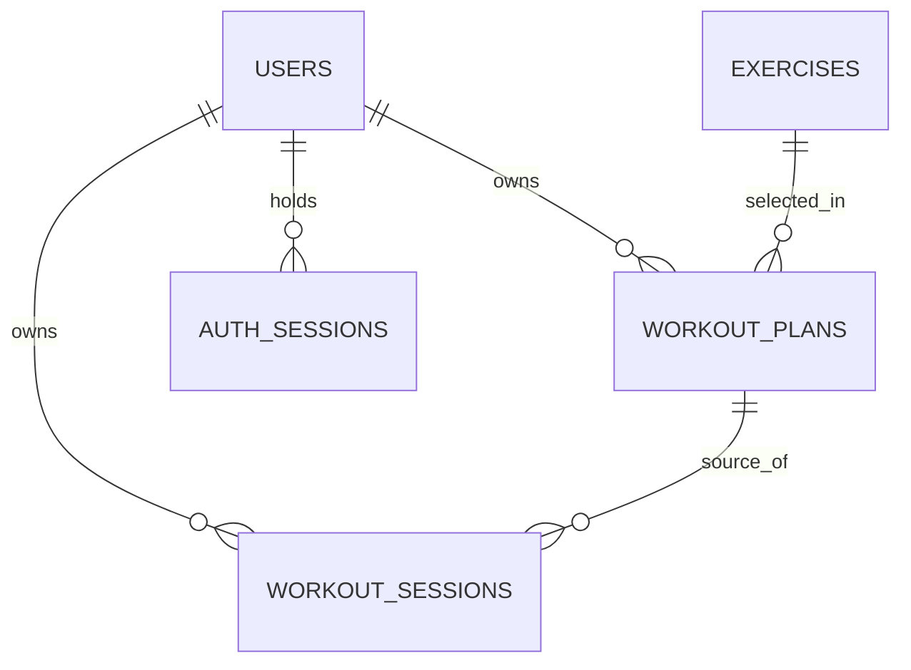

## 12. Deployment diagram
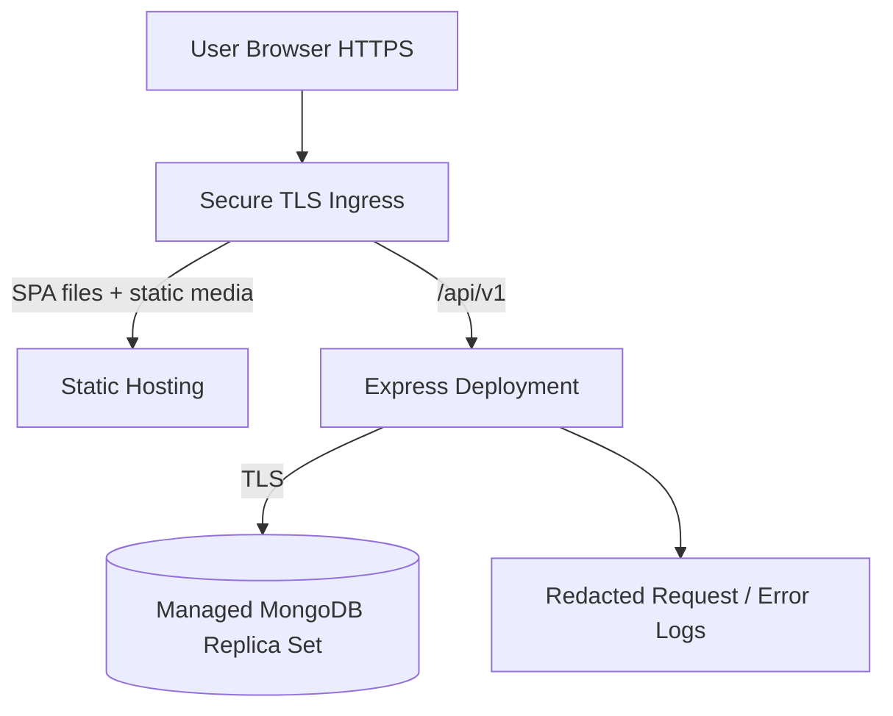

## 13. Diagram review gate
Verify each diagram against actual route names, schema fields and chosen deployment provider once implemented. Replace conceptual labels with deployed topology only when evidence is available. Any new service or trust boundary must trigger architecture/security review.
