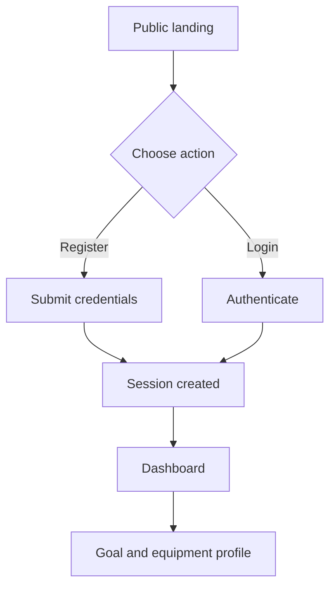
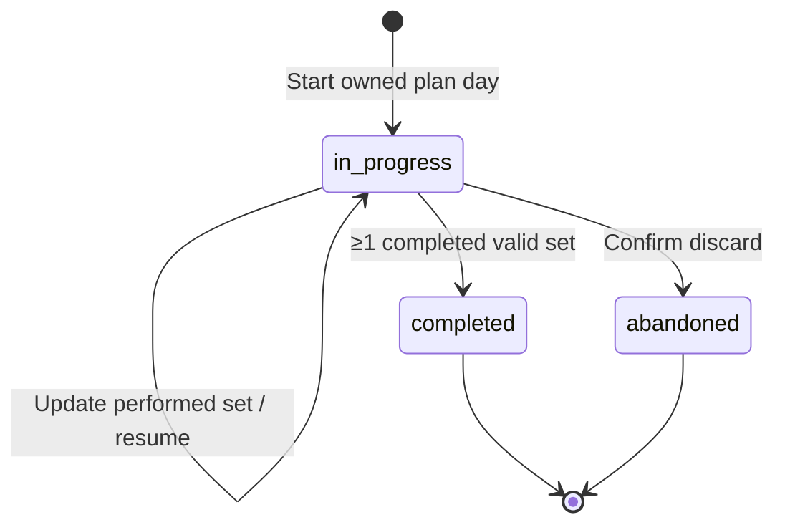

# FitTrack — User Stories, Flows and Acceptance Specifications

> **Project:** FitTrack · **Version:** 2.0 planning baseline · **Prepared:** 2026-11-18  
> **Status:** Design/specification only; no implementation, live deployment, production security, test pass, medical accuracy review, or third-party asset license is claimed.  
> **Constraints:** 2 developers · 8-week delivery window · MongoDB, Express.js, React.js, Node.js (MERN) · responsive web app.  

## 1. Actors and permissions
- **Visitor:** Landing, register/login; no access to personal exercises API (v1 catalog requires authenticated user).
- **Authenticated personal user:** Own profile, plans, sessions, history, progress; shared seeded catalog read-only.
- **Seeder/operator:** Offline protected catalog seed or metadata audit scripts; **no public administrator UI**.

## 2. Story map
| Story ID | Need | Given / When / Then acceptance | Priority |
|---|---|---|---|
| US-01 | Discover the product | Guest on `/` -> hero and final 100dvh-compatible sections -> CTA routes to actual auth page; keyboard works | P0 |
| US-02 | Create account | Valid name/email/password -> server creates account/session; duplicate normalized email rejected | P0 |
| US-03 | Resume signed-in app | Valid cookie + refresh -> protected state loaded from API; expired login is rejected | P0 |
| US-04 | Choose fitness goal | Set muscle_gain -> future relevant ordering, all other exercises remain accessible | P0 |
| US-05 | Find an exercise | Filter Chest + Dumbbells + Beginner -> DB results show truthful count, clear resets | P0 |
| US-06 | Learn movement | View instructions -> validated animation plays if available; text and fallback work otherwise | P0 |
| US-07 | Plan independently | Create Push and Full Body plans -> distinct IDs and persisted after re-login | P0 |
| US-08 | Log actual session | Start valid plan day -> edit reps/weight and completion state -> save confirmed by API | P0 |
| US-09 | Recover session | After acknowledged save, refresh/re-login -> same performed sets; not a new session | P0 |
| US-10 | Finish accurately | At least one completed valid set -> completion once; history shows exact snapshot | P0 |
| US-11 | Archive without corruption | Edit/archive source plan -> old completed session remains unchanged | P0 |
| US-12 | Trust my privacy | Use another account's private resource ID -> 404 and no leak | P0 |
| US-13 | Inspect progression | Completed sessions -> history, trend, count, units and date boundaries are consistent | P0 |
| US-14 | Manage failed save | Network failure -> 'Not saved/uncertain', refetch/retry; never false success | P0 |
| US-15 | Reduced motion/WebGL fail | Motion preference off or WebGL unsupported -> static instruction/illustration and CTA remain usable | P0 |

## 3. Key journey diagrams
### Visitor to active account

### Actual workout

## 4. Detailed acceptance scenarios
**Scenario A — data not targets:** Plan Bench Press 3×10. Actual 12×40, 10×45, 8×50. History must show three actual values; no invented target repetitions. Resistance volume = 12×40 + 10×45 + 8×50 = **1,330 kg-reps** (external load, not total mechanical work).

**Scenario B — racing browser tabs:** Two tabs POST start requests with different idempotency keys; exactly one `in_progress` per user. Rejected response safely identifies their active session if authenticated. Do not rely on React button disabled alone.

**Scenario C — asset pending:** Catalog exercise without an audited clip displays instructions and consistent poster/placeholder. It must not show random movement or a 'verified technique' badge.

**Scenario D — multi-account:** User A creates a private plan; User B requests A's ID via GET/PATCH/DELETE and receives safe not-found without knowing ownership.

**Scenario E — uncertain network:** A PATCH timed out after commit; client reads back `/sessions/:id` before retry; status labels distinguish pending, saved and uncertain.

## 5. Human factors
Sensible validation errors; show unit labels `kg`, `reps`, `sec`; no 3D autoplay when reduced motion is requested; keyboard accessible dialogue/menus; onboarding is skippable; role assumptions never appear in payload.
